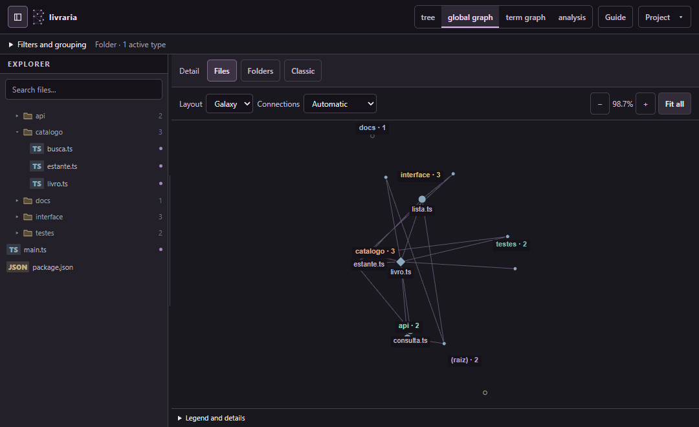

<div align="center">



### Repository Architecture Visualization & Dependency Mapping Engine

BeckaRepo transforms complex repositories into dynamic relational graphs, allowing developers and software architects to visually explore project structure, dependencies, symbols, Git hotspots, and architectural metrics in real time.

---


</div>

---

[Illustrated Manual (`docs/MANUAL.md`)](docs/MANUAL.md) · [Technical Roadmap](docs/ROADMAP.md) · Also available in-app via the **Guide** button (PT / EN).

---

# Overview

BeckaRepo is a **native desktop application** for repository architecture visualization, dependency analysis, and codebase intelligence.

Instead of manually navigating folders and tracing imports across thousands of files, BeckaRepo builds an interactive relational representation of your local repository — helping developers and architects explore:

- **File & Module Dependencies** backed by Tree-sitter syntactic parsing and evidence ranges
- **External Package Graphs** across npm, Cargo, and Maven manifests and lockfiles
- **Intra-File Symbols & Complexity** with local lexical call graphs
- **Structural Metrics** including dependency cycles (SCC), PageRank, and betweenness centrality
- **Git History & Insights** with commit timelines, churn hotspots, and co-change analysis
- **Large-Scale Visualization** tested on repositories with **85,000+ files and 91,000+ connections**

**All analysis, Git inspection, and SQLite storage execute locally in Rust — no code execution, no network calls, and no data leaves your machine.**

---

# What Changed: From v1.1.0 to v2.0.0

> **Why v2.0.0?** Both `v1.0.0` (74.4 MB) and `v1.1.0` (75.9 MB) were built on **Electron + Node.js**, using JavaScript regex heuristics (`parser.js`) and browser `localStorage`. The current codebase is a **ground-up architectural rewrite** to **Tauri 2 + Rust**, replacing the runtime, analysis engine, storage layer, IPC transport, and large-graph renderer while introducing syntactic parsing, external package mapping, symbol complexity, structural graph analytics, Git insights, and a standalone CLI.

## v1.1.0 → v2.0.0 Comparison

| Dimension | v1.1.0 (Electron) | v2.0.0 (Tauri 2 + Rust) |
|---|---|---|
| **Desktop Runtime** | Electron 29 + Node.js (`main.js`, `preload.js`) | **Tauri 2 + Rust** (`src-tauri/`, WebView2) |
| **Installer Size (Windows)** | `75.9 MB` (`BeckaRepo.Setup.1.1.0.exe`) | **`4.98 MB`** NSIS setup (~93.4% smaller) |
| **Analysis Engine** | JavaScript heuristics (`src/utils/parser.js`) | **Native Rust core** (`crates/beckarepo-core/`, 11,393 Rust LOC across workspace) |
| **Syntactic Parsing** | Regex / heuristic only | **Tree-sitter** (`0.25.10`) for JS/JSX/TS/TSX/Rust + heuristic fallback for YAML/RSI/Docker/CI |
| **Module Resolution** | Path/string heuristics | **`tsconfig`/`jsconfig`** (`paths`, `baseUrl`, `extends`), **Cargo** targets/workspaces, Rust `mod` tree & `#[path]` |
| **External Dependencies** | — | **npm, Cargo, Maven** manifests & lockfiles, consumer evidence, indirect impact |
| **Symbols & Complexity** | — | **On-demand Tree-sitter symbols**, Decisions v1 complexity, intra-file call graph |
| **Structural Analytics** | Clustering (Folder, Semantic, LPA, Type) + N-Hop | Adds **Rust SCC cycles** with witness paths, **PageRank**, **betweenness centrality** |
| **Git Integration** | — | **Per-file Git history**, worktrees, churn **hotspots**, **co-change** pairs & overlay, `.mailmap` authorship |
| **Graph Layouts & Scale** | SVG (≤ 800) + Canvas + Ultra Mode (> 15k) | **Galaxy, Atlas, Free (Web Worker), Classic (SVG)** + **Dense Canvas** (85k+ files) + **Folder** drill-down |
| **Persistence** | `localStorage` (`beckarepo_tags_<name>`) | **Bundled SQLite (`rusqlite 0.38`)** — tags, notes, preferences, 5-slot backup/restore, JSON import, folder reassociation |
| **Search & Preview** | In-memory Term Graph search + code preview | **Paginated native Rust search**, cooperative cancellation, **image/audio/video preview** (up to 128 MiB) |
| **IPC & Refresh** | Direct Electron IPC | **Batched IPC** (256 items / 256 KiB), atomic snapshot swap, **incremental refresh** |
| **CLI Tool** | — | **`beckarepo-cli`** (JSON v2 snapshot without raw source + `--json` v1 compatibility) |
| **Frontend & Docs** | 9 components, 4 hooks, 1 modal doc | **22 React components**, 7 hooks, 2 Web Workers, **23 docs** + 22 screenshots (PT/EN) |
| **Automated Tests** | — | **21 JavaScript tests** + **64 Rust workspace tests** |

---

# Core Features

## Syntactic Parsing & Module Resolution

Powered by compiled **Tree-sitter** grammars (`tree-sitter-javascript`, `tree-sitter-typescript`, `tree-sitter-rust`) inside `beckarepo-core`:

- **JS / JSX / TS / TSX**: static imports, re-exports, and literal `require`/`import` calls, resolved against `tsconfig.json` / `jsconfig.json` (`paths`, `baseUrl`, and `extends` JSONC chains).
- **Rust & Cargo**: `mod` declarations (external and inline), literal `#[path]` attributes, logical `crate`/`self`/`super` navigation, Cargo targets (`lib`, `bin`, `src/bin`, examples, tests, benches, build scripts), and `workspace.dependencies` inheritance.
- **Heuristics**: YAML, RSI, Docker, CI, and additional languages remain supported via the bounded Rust regex extractor.
- **Parsing & Evidence Panel**: inspect the extraction engine, UTF-8 byte spans, line numbers, bindings, Cargo target contexts, resolution method, and diagnostics per file.

## External Package Dependencies

Offline manifest and lockfile inspection (never executes package managers or network requests):

- **Ecosystems**: **npm** (`package.json`, `package-lock.json` v2/v3, `npm-shrinkwrap.json`), **Cargo** (`Cargo.toml`, `Cargo.lock` v3/v4), and **Maven** (`pom.xml`).
- **Package Insights**: compare declared vs. observed lockfile versions, inspect direct file consumers with line evidence, filter by ecosystem/status/category, and query indirect impact chains.

## On-Demand Symbols & Complexity

Open the **Symbols** tab on any supported file (JS/JSX, TS/TSX, Rust) for on-demand Tree-sitter analysis:

- Extracts functions, methods, classes, structs, enums, traits, interfaces, modules, and named types.
- **Cyclomatic Complexity (Decisions v1)**: scores branching constructs (`if`, loops, `catch`, ternary, `switch` cases, `&&`/`||`, Rust `match` arms and `?` propagation) with line/byte evidence.
- **Intra-File Call Graph**: conservative lexical call resolution with an expandable interactive graph (up to 40 symbols / 80 edges per page) and bounded 24 KiB code preview.

## Multi-Layout Graph & Dense Canvas

Four global layouts plus progressive folder exploration:

| Mode | Description |
|---|---|
| **Galaxy** | Radial layout placing highly connected hubs near the center (inbound neighbors weighted 2×, outbound 1×) |
| **Atlas** | Allocates spatial areas per group proportional to file count |
| **Free** | Force-directed simulation offloaded to a **Web Worker** (`denseLayout.worker.js`), preserving pinned nodes |
| **Classic** | High-detail SVG mode for graphs up to 800 nodes |

For repositories above 800 files, the **Dense Canvas** renderer (`DenseGraphCanvas.jsx`) activates automatically:

- Zoom from `0.002×` to `64×` with CSS-pixel sizing and collision-aware labels (up to 80 visible labels).
- Spatial grouping in `24×24 px` cells with hysteresis (`3,000 → 2,000`) to avoid flicker.
- Explicit edge budgets: `1,200` (auto overview), `5,000` (focused selection), `12,000` (all), with deterministic sampling and direction arrows.
- **Folder Drill-Down** (`FolderGraphCanvas.jsx`): progressively expand/collapse directories and inspect aggregated folder connections while keeping the selected file individual.
- **Node Glyphs**: hollow circles mark isolated files, filled circles mark connected files, and diamonds highlight hubs with 8+ connections in the active filter.

## Structural Metrics (Rust)

Computed in `src-tauri/src/structure.rs` on the full dependency projection (`import`, `require`, `re-export`, and optional `prototype-parent`), with cooperative cancellation and a 30-second budget:

- **Dependency Cycles**: iterative Kosaraju strongly connected components (SCC) with closed witness paths.
- **Centrality & Degree**: in-degree, out-degree, **PageRank** (0.85 damping, max 60 iterations, L1 tolerance `1e-8`), and **betweenness centrality** (exact Brandes up to 256 eligible sources, deterministic sampling above that).

## Git History, Hotspots & Co-Change

Read-only Git integration via `std::process::Command` (no shell invocation, no remote protocols; requires `git` on `PATH`):

- **Per-File History**: branch/HEAD detection, linked worktrees, `--follow` rename tracking, commit timeline, churn frequency over 7/30/90/365-day windows, and byte-level comparison against the Git index.
- **Project Git Insights**: paginated **Hotspots** (weighted score combining churn, commit frequency, and recency), **Co-Change** pairs with conditional probabilities `P(B|A)` / `P(A|B)`, optional `.mailmap`-normalized authorship, and a dashed **Co-Change overlay** in the graph.
- **Persistent Git Cache**: regenerable SQLite cache (`git_cache`) keyed by worktree, scope, HEAD, window, and algorithm version.

## SQLite Persistence, Notes & Customization

- **Local SQLite Database** (`beckarepo.sqlite` via `rusqlite 0.38`): stored in the OS local app data directory, never polluting the analyzed repository.
- **Tags & Notes**: worktree-scoped annotations with in-memory drafts, close-protection prompts, conflict revision checks, and explicit folder reassociation for moved projects.
- **Backups & Migration**: automatic pre-migration and manual consistent SQLite backups (5-file retention), verified restore, idempotent JSON import, and automatic import of legacy `localStorage` data (`beckarepo_tags_<root>`).
- **UI Personalization**: runtime **Portuguese / English** switching, resizable panels, customizable accent color and graph spacing.

## Native Search, Previews & Export

- **Native Full-Text Search**: case-insensitive literal search in Rust across paths and eligible text files, paginated (200 hits/batch up to 2,000), with coverage reporting and cancellation.
- **Media & Code Inspection**: tokenized code view plus native previews for images, audio, and video (up to 128 MiB).
- **Markdown Export**: export repository tree and statistics via native save dialog.
- **Incremental Refresh**: button-triggered rescan that reuses valid cached relations and updates only changed files.

---

# System Architecture

```
┌──────────────────────────────────────────────────────────────────────┐
│  Frontend (React 19 + D3.js 7 + Vite 8)                              │
│  ├── 22 Components (DenseGraphCanvas, FolderGraphCanvas,             │
│  │     SymbolPanel, PackageInsights, GitHistoryPanel,                │
│  │     RepositoryInsights, ParsingEvidence, ManualModal, ...)        │
│  ├── 7 Hooks (useNativeAnalysis, useRepositorySearch, useTags, ...)  │
│  └── 2 Web Workers (denseLayout.worker.js, denseLayoutRuntime.js)    │
├──────────────────────────────────────────────────────────────────────┤
│  Tauri 2 IPC (28 commands · batched transport: 256 items / 256 KiB)  │
├──────────────────────────────────────────────────────────────────────┤
│  Desktop Host (src-tauri/src/ — 10 Rust modules)                     │
│  ├── main.rs         Session lifecycle, file/asset/symbol/search IPC │
│  ├── transport.rs    Cursor-based batched snapshot delivery          │
│  ├── storage.rs      SQLite schema v2, tags/notes, backups, prefs    │
│  ├── structure.rs    SCC cycles, PageRank, betweenness centrality    │
│  └── git/            Read-only Git history, hotspots, co-change      │
├──────────────────────────────────────────────────────────────────────┤
│  Analysis Engine (crates/beckarepo-core/ — 19 Rust files)            │
│  ├── repository.rs   Walkdir scanner, revisions, snapshots, search   │
│  ├── analysis.rs     Two-pass indexing & relation graph construction │
│  ├── parser.rs       Heuristic/regex + Tree-sitter integration       │
│  ├── syntax.rs       Tree-sitter grammars & evidence extraction      │
│  ├── web_resolution  tsconfig / jsconfig paths, baseUrl & extends    │
│  ├── cargo_resolution Cargo.toml workspaces, targets & dependencies  │
│  ├── rust_modules.rs Logical mod tree, #[path], crate/self/super     │
│  ├── packages.rs     npm, Cargo & Maven manifests + lockfiles        │
│  ├── symbols.rs      On-demand symbols, complexity & call graph      │
│  ├── policy.rs       File limits & sensitive-path blocking           │
│  └── beckarepo-cli   Standalone CLI binary                           │
└──────────────────────────────────────────────────────────────────────┘
```

### Repository Structure

```
beckarepo/
├── crates/beckarepo-core/      # Pure Rust analysis engine + CLI
│   ├── src/                    # Core modules + bin/beckarepo-cli.rs
│   ├── tests/                  # Integration tests (cli, contract, packages, path_attributes, phases, symbols)
│   └── examples/profile_scan.rs
├── src-tauri/src/              # Tauri 2 desktop host (SQLite, Git, Structure, IPC)
├── src/                        # React 19 + D3 7 frontend
│   ├── components/             # 22 UI components
│   ├── hooks/                  # 7 custom React hooks
│   ├── workers/                # Web Worker physics simulation
│   ├── utils/                  # Galaxy/Atlas layouts, clustering, folder projection
│   └── services/               # Tauri IPC client
├── tests/                      # JavaScript test suite (appearance, folder projection, UI utils)
├── docs/                       # Illustrated manual, roadmap, ETAPA_F1–F8, validation reports, 22 screenshots
├── Cargo.toml                  # Rust workspace
└── package.json                # Node scripts & frontend dependencies
```

---

# Performance & Benchmarks

Measured on a real-world repository with **85,224 files and 91,744 connections** (see [validation report](docs/validation/2026-11-25/RELATORIO_GRAFO.md)):

| Metric | Measurement |
|---|---|
| **Full Rust scan (release profile)** | **~236 s** (down from 351 s after path-set sharing & parallel revision checks) |
| **Global Graph open (85k files)** | **~2.0 s** from click to interactive Canvas |
| **Galaxy / Atlas grouping** | 214 spatial groups (Galaxy) / 584 groups (Atlas), 1,200 overview edges drawn |
| **Windows NSIS Installer** | **4.98 MB** (`5,217,995` bytes) vs. `75.9 MB` in v1.1.0 |

Run the release scanner benchmark on any local folder:

```powershell
cargo run --release --offline -p beckarepo-core --example profile_scan -- "D:\path\to\repository"
```

---

# Getting Started

## Prerequisites (Windows)

- **Rust** (stable toolchain with MSVC)
- **Visual Studio Build Tools** with **Desktop development with C++** and Windows SDK
- **Node.js** `20.19+` or `22.12+` (required by Vite 8)
- **Microsoft Edge WebView2 Runtime** (pre-installed on Windows 10/11)

See the [official Tauri prerequisites](https://v2.tauri.app/start/prerequisites/).

## Run in Development

```powershell
npm install
npm run dev
```

Starts Vite and opens the native Tauri window (the first Rust compilation may take a few minutes).

## Build Executable & Installer

```powershell
npm run build
```

- **Executable**: `target/release/beckarepo.exe`
- **Windows Installer**: `target/release/bundle/nsis/` (also via `npm run build:exe`)

The compiled application runs standalone without Node.js, npm, or Vite.

## Rust-Only CLI

```powershell
cargo run -p beckarepo-core --bin beckarepo-cli -- "D:\path\to\repository"
```

Outputs a **JSON v2 snapshot** with file metadata, graph, packages, and statistics (no raw source text). Pass `--json` for the legacy v1 analysis contract.

## Commands Reference

| Command | Purpose |
|---|---|
| `npm run dev` | Start Vite + native Tauri window |
| `npm run dev:vite` | Frontend only in browser (repository analysis requires Tauri) |
| `npm run build` | Build executable and installer |
| `npm run build:ui` | Build frontend assets only |
| `npm run build:exe` | Build NSIS Windows installer |
| `npm run check:rust` | Type-check the Rust workspace |
| `npm run test:core` | Run `beckarepo-core` tests |
| `npm run test:rust` | Run all Rust workspace tests |
| `npm run lint` | Run ESLint on frontend code |
| `cargo fmt --all` | Format Rust workspace sources |

---

# Limits & Safety Guarantees

- **Sensitive File Blocking**: `.env`, private keys, credentials, and excluded directories (`node_modules`, `target`, etc.) are blocked prior to reading.
- **Per-File & Corpus Caps**: text files `≥ 500 KiB` are skipped; scanner processes one file at a time up to `100,000` files; media previews capped at `128 MiB`.
- **No Code Execution**: neither Tree-sitter, Cargo/npm/Maven readers, nor Git commands execute repository scripts or connect to the network.
- **Cooperative Cancellation**: repository scan, search, Git queries, and structural metrics support cancellation and explicit error reporting instead of silent truncation.

See [File Policy (`docs/POLITICA_DE_ARQUIVOS.md`)](docs/POLITICA_DE_ARQUIVOS.md) for full details.

---

# Documentation & Validation

| Document | Description |
|---|---|
| [Illustrated Manual](docs/MANUAL.md) | Step-by-step user guide with 22 screenshots (PT & EN) |
| [Technical Roadmap](docs/ROADMAP.md) | Phased delivery plan (F0–F8) and future goals |
| [Architecture Plan](docs/ARQUITETURA_ROADMAP.md) | Architecture evolution and schema contracts |
| [File Policy](docs/POLITICA_DE_ARQUIVOS.md) | Reading rules, exclusions, and memory budgets |
| [Rust Migration](docs/MIGRACAO_RUST.md) | Native migration details and known gaps |
| [UI Direction](docs/INTERFACE.md) | Visual design language and palette |
| [Phase Reports](docs/) | [F1](docs/ETAPA_F1.md) · [F2](docs/ETAPA_F2.md) · [F3](docs/ETAPA_F3.md) · [F4](docs/ETAPA_F4.md) · [F5](docs/ETAPA_F5.md) · [F6](docs/ETAPA_F6.md) · [F7](docs/ETAPA_F7.md) · [F8](docs/ETAPA_F8.md) |
| [Validation Reports](docs/validation/) | Automated test results, benchmarks, and visual checks |

---

<div align="center">

# Credits

Created with dedication to software engineering, visualization systems, and developer experience.

### Message for Rebecka

> *"From one friend to another."*

</div>
