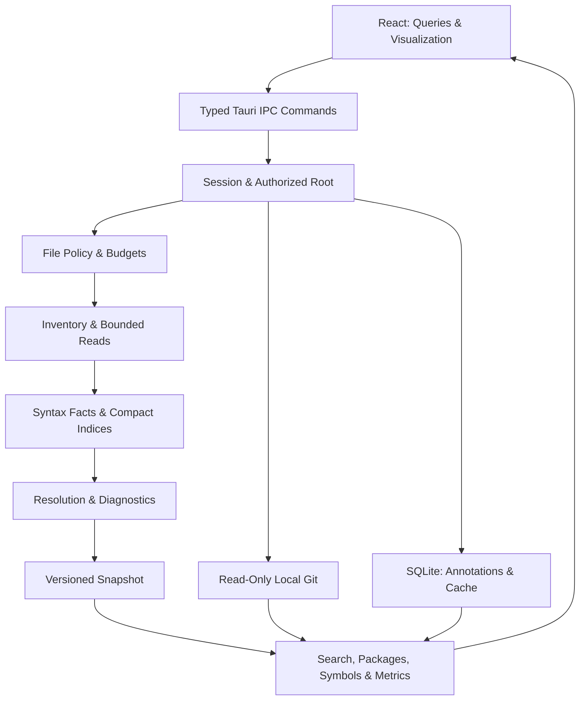

# Architecture Plan & Contract Transition

> Reference architecture blueprint created for the Rust/Tauri evolution. Phases F0–F8 have since been implemented across `crates/beckarepo-core/` and `src-tauri/src/` — see [ETAPA_F1.md](ETAPA_F1.md)–[ETAPA_F8.md](ETAPA_F8.md) and [ROADMAP.md](ROADMAP.md) for exact implemented schemas and commands.

## Architectural Decisions

1. **Rust is the local data authority.** Rust authorizes repository roots, enforces read policies, executes parsing, search, Git queries, structural analytics, and SQLite persistence. React presents results and invokes bounded commands.
2. **Evolve the existing core incrementally.** Add internal modules only when backed by real implementations and consumers — avoiding speculative empty crates or abstractions.
3. **On-demand source text.** Separate file inventory, extracted facts, resolution, and content previews; do not hold raw source text for the entire repository in memory.
4. **Local SQLite for durable state.** Prefer host-managed SQLite over browser `localStorage`/`IndexedDB` for persistent user annotations and preferences.
5. **Typed, evidence-backed relations.** Structural imports, historical co-change, and visual clustering remain distinct projections with separate filters.
6. **Separate syntactic parsing from resolution.** Tree-sitter extracts per-file syntax facts (`syntax.rs`) while bounded resolvers map config aliases, Cargo targets, and module trees; `regex` remains an explicitly labeled fallback.
7. **Measure before changing graphics backends.** Enforce node/edge budgets, folder LOD, and off-thread Web Worker physics before evaluating WebGPU or Wasm ports.

## Data Flow

The filename exclusion policy runs before reading, parsing, or caching across general scanning, manifest/lockfile parsing, and Git inspection.

## Contract Evolution

### Legacy v1 (`AnalysisRequest` / `AnalysisResult`)

`AnalysisRequest` accepts `RepositoryFile { path, name, size, content }`. The analyzer returns `AnalysisResult { schemaVersion, nodes, edges, stats, packages }` (with `packages` added cleanly as an additive field in F6). `--json` CLI mode continues supporting v1 stdin/stdout for compatibility.

### Desktop Snapshot Envelope v2 (Implemented in F1)

Desktop sessions separate transport envelope versioning, snapshot revisions, and extractor versions:

| Entity | Core Fields | Rule |
| --- | --- | --- |
| **Repository** | Persistent 128-bit ID, known canonical locations | Never identified solely by folder name or remote URL. |
| **Worktree** | ID, `repositoryId`, authorized root | Git history may be shared across worktrees while annotations/layout stay scoped. |
| **AnalysisSession** | Ephemeral ID, `worktreeId`, revision, active state | Only the active session authorizes file reads and IPC batches. |
| **File** | ID (`path`), relative path, size, revision, `contentState` | No raw source text retained in snapshot. |
| **Symbol** | Revision-scoped ID, path, kind, qualified name, byte range | Never used as permanent note anchors across edits. |
| **Package** | ID, ecosystem, manifest, category, alias, declared/resolved versions | Separates declaration, lockfile resolution, and actual source imports. |
| **Relation** | Source/target, category, kind, evidence, direction | Structural, historical, package, and visual edges remain cleanly separated. |
| **Diagnostic** | Engine, version, messages, omitted count | Distinguishes skipped, denied, oversized, unresolved, errored, and canceled states. |
| **Metric** | Version, universe, parameters, window/revision | Never mixes results across different snapshots or time windows. |

Entity IDs are namespaced by kind so package identifiers never collide with file paths, and mutable D3 layout objects never flow back into the Rust core.

## Memory & Streaming Pipeline

1. Inventory relative paths and revisions while applying exclusions and file-count limits.
2. Read one bounded file at a time (`< 500 KiB`) to build compact identifier/module indices without retaining full source text.
3. Resolve dependencies across the full inventory, streaming snapshot sections to the UI in `256-item / 256 KiB` batches (`snapshot_batch` → `finish_snapshot`).
4. Fetch source text, media bytes, symbol extractions, and literal search hits lazily on demand under session and revision checks.

## Storage Separation

| Table Group | Contents | Durability |
| --- | --- | --- |
| `schema_migrations` | Schema version and migration history | Essential |
| `repositories` / `worktrees` / `locations` | Persistent identities and canonical root bindings | Essential |
| `annotations` / `tags` / `annotation_tags` | User notes and tags scoped to `(worktree_id, path)` | User data (prioritized in backups) |
| `preferences` | UI language, panel visibility, accent color, spacing | User data |
| `git_repositories` / `git_worktrees` / `git_scopes` / `git_cache` | Git identity bindings and 7-day regenerable query cache | Cache (isolated from annotation deletion) |

All writes use parameterized queries and short transactions. Consistent backups use SQLite's online backup API (`rusqlite::backup`).

## Graph Projections

- **Structural:** resolved `import`, `require`, `re-export` (and optional `prototype-parent`) edges used for SCC cycles, degree, PageRank, and betweenness.
- **Historical:** Git co-change and churn within an explicit commit/time window — never treated as import cycles or runtime call proof.
- **External:** package declarations, lockfile dependencies, and `imports-package` consumer links.
- **Visual:** spatial clusters and folder drill-down aggregations; aggregated visual edges never mutate the underlying model.
