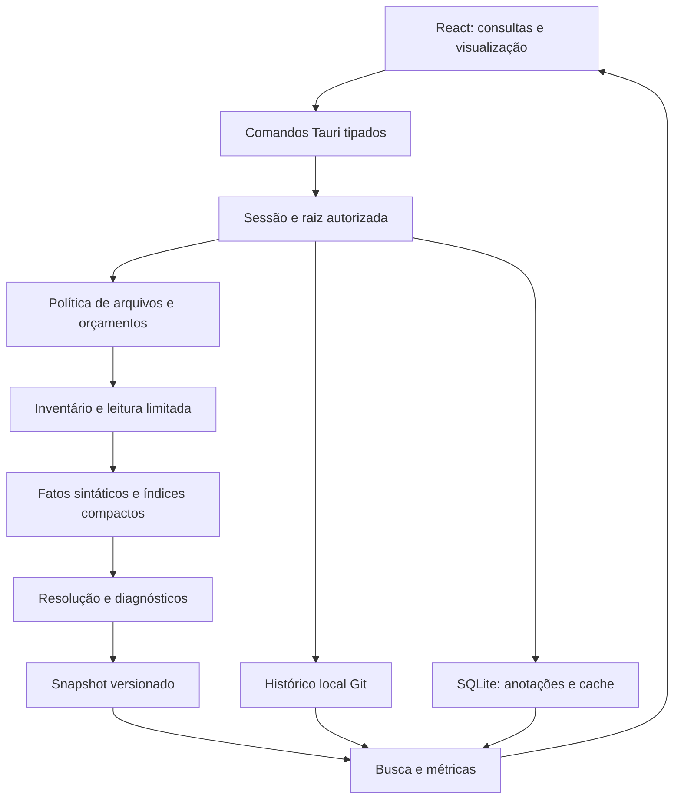

# Arquitetura proposta para o roadmap

> Atualização de 26/10/2026: transporte em lotes e cache de relações de F1, além da base SQLite de F2, já foram implementados. Consulte [ETAPA_F1.md](ETAPA_F1.md) e [ETAPA_F2.md](ETAPA_F2.md) para os contratos e tabelas reais; os demais modelos deste documento continuam propostas.

**Status: desenho de referência, parcialmente implementado em F1.** O snapshot sem texto, leitor sob demanda e busca nativa já existem; os comandos efetivos e limites estão em [ETAPA_F1.md](ETAPA_F1.md). As demais propostas abaixo continuam futuras.

**Registro do desenho original:** Exceto `policy.rs`, os serviços, comandos, entidades e tabelas descritos aqui ainda não existem. Nenhum desses nomes deve ser exibido como recurso disponível.

## Decisões

1. **Rust é a autoridade de dados locais.** Autoriza raízes, aplica a política de leitura, executa parsing, consultas, Git e persistência. React apresenta resultados e solicita operações limitadas.
2. **Evoluir o núcleo existente.** Novos módulos internos só serão criados quando tiverem implementação e consumidor. Não criar microserviços, crates vazias ou abstrações para backends fictícios.
3. **Texto sob demanda.** Separar inventário, fatos extraídos, resolução e consultas. Um cache limitado pode manter os últimos conteúdos; persistir todo o código não é o padrão.
4. **SQLite local para dados duráveis.** Preferir um banco gerenciado pelo host Rust a IndexedDB como fonte principal de anotações. A integração e o binding serão escolhidos em F2.
5. **Relações têm natureza e evidência.** Dependência estrutural, coalteração histórica e agrupamento visual não compartilham significado nem filtros analíticos.
6. **Parsing sintático é separado de resolução semântica.** A estratégia regex existente pode continuar como fallback identificado. Tree-sitter entra por linguagem e por cobertura.
7. **Desempenho decide o backend gráfico.** Começar com limites, LOD por pastas e isolamento da física; só então selecionar Wasm/GPU com medições.

## Fluxo desejado

A política de nomes deve preceder leitura, parsing e persistência. Leitores especializados de manifests/lockfiles e Git precisam aplicar a mesma proteção, mesmo quando sua seleção de formatos difere da seleção do scanner geral.

## Evolução do contrato

### Antes de F1: v1

`AnalysisRequest` recebe `RepositoryFile { path, name, size, content }`. O scanner devolve `RepositorySnapshot { repositoryId, name, files, graph, warnings }`. A UI depende de `content` para pesquisa e prévia. `Edge.type` é uma string. `repositoryId` é a raiz canônica.

### Proposta v2 — envelope iniciado em F1, entidades futuras

Separar versão do transporte, revisão do snapshot e versão dos algoritmos. Manter v1 explícito para a CLI durante a transição; rejeitar versões desconhecidas. Não enviar nós novos para um renderer v1 que espera somente arquivos.

| Entidade | Dados propostos | Regra |
| --- | --- | --- |
| Repository | ID persistente, locais conhecidos | Não identificar pelo nome da pasta. URL remota não é identidade suficiente. |
| Worktree | ID, repositoryId, raiz autorizada | Histórico pode ser compartilhado; arquivos/preferências de layout podem divergir. |
| AnalysisSession | ID efêmero, worktreeId, revisão, opções | Somente a sessão ativa autoriza leituras e recebe resultados. |
| File | ID, path relativo, tamanho, fingerprint, estado de conteúdo | Sem texto bruto no snapshot; hash/mtime não são garantia de atomicidade. |
| Symbol | ID de snapshot, fileId, espécie, nome qualificado, range em bytes | Anotações persistentes precisam de estratégia de reancoragem após edições. |
| Package | ID, ecossistema, nome, origem, versão e escopo | Separar declaração, resolução de versão e uso real. |
| Relation | Origem/destino, categoria, tipo, evidência, confiança | Categorias: structural, historical, reference, visual; filtros separados. |
| Diagnostic | Código, severidade, arquivo opcional, motivo, cobertura | Distinguir ignorado, negado, grande, não resolvido, erro e cancelado. |
| Metric | Nome, versão, valor, universo, janela/revisão | Não misturar resultados de snapshots ou janelas diferentes. |

IDs de entidades precisam de namespace por espécie; um pacote não pode colidir com o caminho de um arquivo. Endpoints continuam normalizados e serializáveis; objetos mutáveis do D3 nunca retornam ao núcleo.

### Comandos previstos, não implementados

- `read_file_content(sessionId, fileId, revision)` → conteúdo limitado, revisão observada e estado.
- `search_repository(sessionId, queryId, query, cursor, limit)` → resultados paginados, cobertura e revisão.
- `query_git_history(sessionId, analysisId, window, limit)` → métricas históricas e metadados da janela.
- `expand_symbols(sessionId, fileId, revision, cursor)` → símbolos/relações limitados.
- `load_annotations(worktreeId)` / `save_annotation(...)` → revisão e confirmação transacional.

`sessionId` é vínculo com autorização mantida pelo host, não uma autorização fabricável pelo cliente. Validar comprimentos, enumerações, contagens, cursores e pertencimento dos arquivos. Operações longas usam identificador, progresso, cancelamento e descarte de respostas obsoletas. Novo erro deve ter código estável e texto traduzível, em vez de depender de comparação de uma mensagem em inglês.

## Pipeline de memória

1. Inventariar caminhos e metadados, aplicando exclusões e teto de arquivos.
2. Ler um arquivo limitado por vez para extrair IDs/fatos que possam ser referenciados adiante, inclusive YAML/RSI. Guardar estruturas compactas, não o texto completo.
3. Resolver relações usando o inventário completo; quando necessário, segunda passagem limitada por arquivo. Medir custo extra de I/O antes de otimizar.
4. Entregar metadados/grafo em lotes com controle de fluxo. Limitar também número e tamanho das arestas/evidências.
5. Buscar conteúdo e trechos sob demanda; manter cache limitado por bytes e revisão. Busca global deve ter cobertura explícita quando arquivos forem excluídos ou não lidos.
6. Somente depois adicionar invalidação incremental/watch e persistência opcional de índices. Arquivos mudando durante leitura podem exigir releitura ou status de inconsistência.

Não chamar esse desenho de memória constante: grafo, índice de caminhos e fatos continuam crescendo. Um hard timeout exige interrupção suportada pelo parser ou isolamento em processo; abandonar uma tarefa assíncrona não para automaticamente o trabalho em thread.

## Persistência planejada

Rascunho de responsabilidade das tabelas, ainda sem SQL/migrações aplicadas:

| Tabela | Conteúdo | Durabilidade |
| --- | --- | --- |
| schema_migrations | Versão, data e resultado de migração | Essencial |
| repositories / worktrees / locations | Identidades e associação com raízes | Essencial |
| annotations / tags / annotation_tags | Notas, tags, referência de arquivo/símbolo, revisão | Dados do usuário |
| preferences | Idioma, filtros e opções por escopo | Dados do usuário |
| analysis_snapshots / file_fingerprints | Revisão e inventário analisado | Cache regenerável |
| git_metrics / metric_cache | Histórico e resultados com versão/janela | Cache regenerável |

Usar consultas parametrizadas, transações curtas, índices adequados e um responsável pela fila de gravação. Não armazenar conteúdo bruto ou segredos por padrão. Backups devem priorizar dados do usuário; política de retenção de cache separada. IDs de anotações não devem desaparecer por exclusão em cascata de um snapshot de cache.

Migração de LocalStorage: ler → validar formato/tamanho → gravar em transação → registrar origem/importação → confirmar sucesso. Falha mantém a origem. Raiz atual pode iniciar o vínculo com novo ID, mas mover um repositório exige reconciliação explícita. Importar dados do antigo Electron é um fluxo distinto.

## Projeções do grafo

- **Estrutural:** imports/includes/reexports resolvidos; utilizada para ciclos e centralidade.
- **Histórica:** coalteração e churn, com commit/janela e suporte; nunca prova de chamada ou dependência de execução.
- **Externa:** declarações e consumidores de pacote; uma dependência transitiva não implica import direto.
- **Visual:** agregações LOD e clusters; seleção pode mapear de volta para membros reais, mas arestas agregadas não alteram o modelo persistido.

Métrica deve declarar sua projeção. Busca pode destacar um arquivo oculto em supernó por contagem/badge e oferecer expansão. Gradiente de calor não deve apagar indicação de seleção, foco de teclado ou resultado de busca.

## Estratégia de transição

1. F0 mantém o contrato v1 e centraliza proteção.
2. F1 introduz transporte v2 junto do leitor e da busca nativos. Só remover `content` do snapshot quando esses consumidores estiverem migrados.
3. F2 migra persistência e fornece edição real de notas/tags.
4. F3–F7 adicionam entidades/relações conforme os respectivos produtores e consumidores existirem.
5. F8 altera apresentação/layout sem redefinir identidade e significado das relações.

Ver critérios e tarefas em [ROADMAP.md](ROADMAP.md). A validação prevista deve ser solicitada/executada na implementação de cada fatia; os diagramas são desenho, não evidência de funcionamento.
