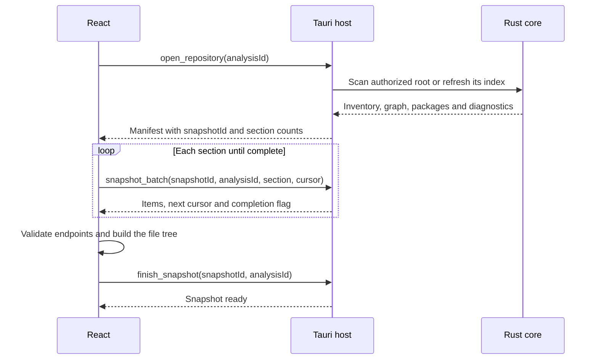

# BeckaRepo architecture

BeckaRepo opens a local worktree and represents it as a versioned snapshot. The Rust core inventories files and resolves relationships. The Tauri host owns the authorized root, the active session and the local database. React builds the explorer, graph views and file panel from the snapshot.

## Opening a repository

The client checks each batch against its analysis ID, snapshot ID, cursor and expected count. The seven sections carry files, file nodes, file edges, warnings, package nodes, package edges and package diagnostics. Batches are bounded to 256 items and 256 KiB. A canceled or incomplete transfer cannot publish a partial graph. [IPC client](../src/services/analysisClient.js) · [Native transport](../src-tauri/src/transport.rs)

## Code ownership

| Area | Responsibility | Entry point |
| --- | --- | --- |
| File inventory and revisions | Apply the file policy before reading, build compact indices and reuse eligible results on refresh. | [Repository scanner](../crates/beckarepo-core/src/repository.rs) |
| Parsing and resolution | Extract syntax facts for JS/JSX, TS/TSX and Rust, resolve paths against the inventory and retain diagnostics and evidence. Dedicated resolvers handle web configuration, Cargo targets and Rust modules. | [Core modules](../crates/beckarepo-core/src/) |
| Desktop commands | Authorize the selected folder, manage analysis lifetime and cancellation, and serve text, assets, search and symbols on demand. | [Tauri host](../src-tauri/src/main.rs) |
| Analysis queries | Compute structural metrics on a directed projection. Query local Git history, churn and co-change using the selected worktree and history window. | [Structure](../src-tauri/src/structure.rs) · [Git](../src-tauri/src/git.rs) |
| Rendering | Hydrate file metadata and path lookups, apply view filters, then draw the active projection. | [Main view](../src/RepoVisualizer.jsx) · [Dense canvas](../src/components/DenseGraphCanvas.jsx) |
| User data | Persist worktree identities, notes, tags and preferences in the app data directory. Manage transactions, migrations, backups and the regenerable Git cache. | [SQLite storage](../src-tauri/src/storage.rs) |

## Snapshot and content contracts

The desktop and directory CLI use a **v2 snapshot envelope**. File records carry relative paths, revisions, sizes and content availability. The embedded analysis graph uses the **v1 result schema**. The CLI also accepts the standalone v1 JSON analysis request on stdin with `--json`. The directory CLI emits its snapshot on stdout; batched delivery belongs to the desktop IPC path. [CLI](../crates/beckarepo-core/src/bin/beckarepo-cli.rs) · [Graph validation](../src/core/contract.js)

Source text and media are fetched separately from the graph. On-demand requests identify the snapshot and file so the host can check scope and revision. Path exclusions, file-count and byte limits also apply during indexing. [File policy](POLITICA_DE_ARQUIVOS.md)

## What a graph represents

| Projection | Meaning of a connection |
| --- | --- |
| File dependency | A detected import, reference or other typed relation between files. Structural metrics use a subset of these types. |
| Git co-change | Two files changed together in the selected history window. The evidence is their commit history. |
| Package dependency | A declaration, locked dependency or observed source import. Consumer queries retain the relation type and manifest scope. |
| Symbol calls | A call resolved within the selected file and revision. Dynamic calls can remain unresolved. |
| Folder view | Files project onto visible directories. Edges between representatives sum underlying relations of the same type. |

**Galaxy** places highly connected files nearer the center. **Atlas** allocates space by group size. **Free** sends force-layout work to a Web Worker and returns coordinates to the canvas. The viewport limits drawn lines and labels independently of the snapshot, so zoom and selection can reveal detail in a dense graph. **Classic** offers SVG on smaller graphs. [Layout calculations](../src/utils/galaxyLayout.js) · [Drawing budgets](../src/utils/graphViewport.js) · [Worker](../src/workers/denseLayoutRuntime.js)

## Persistence and appearance

Annotations belong to a worktree and relative path. Explicit reassociation handles a moved worktree. Language, panel visibility, accent and spacing are app preferences. The UI derives CSS and canvas colors from the same palette. The bundled SQLite backup facility covers the database, including preferences. Render coordinates and active viewport state live in the frontend. [Theme](../src/styles/theme.js) · [Illustrated manual](MANUAL.md)

The roadmap describes the remaining coverage and measurement work. [Technical roadmap](ROADMAP.md)
