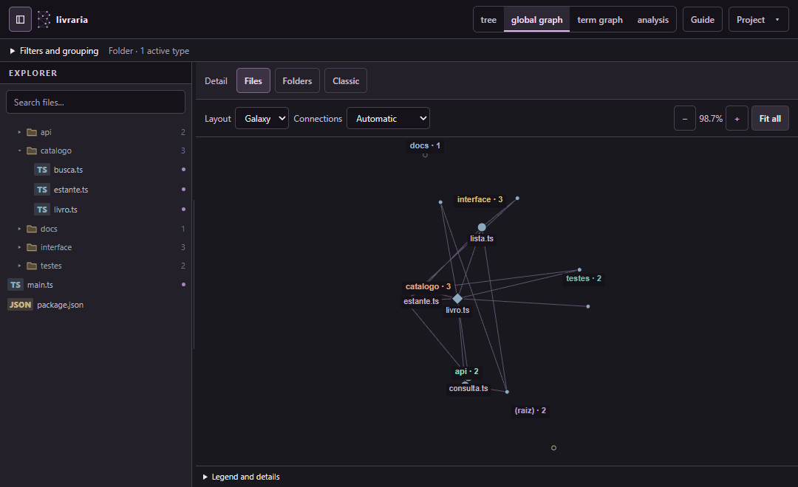
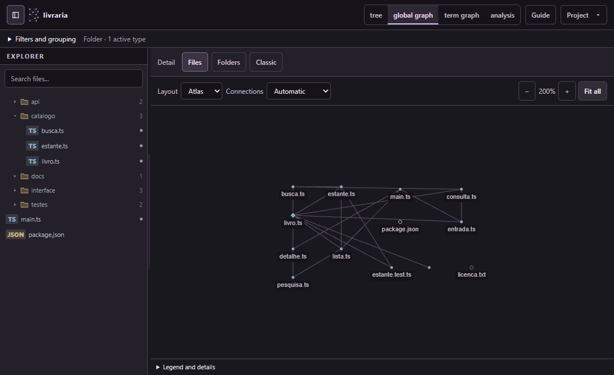
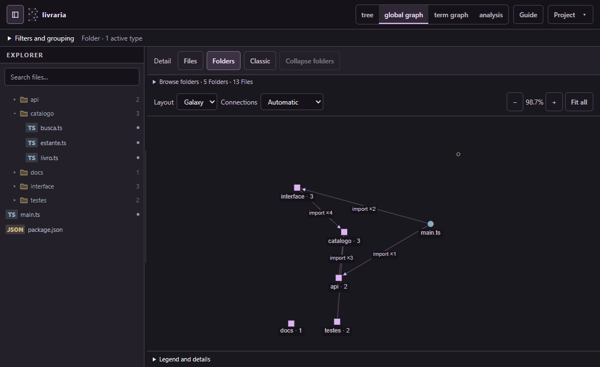
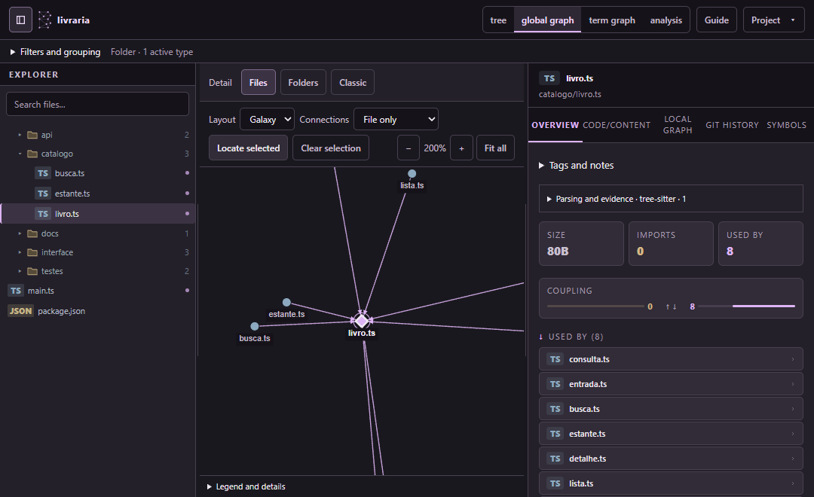
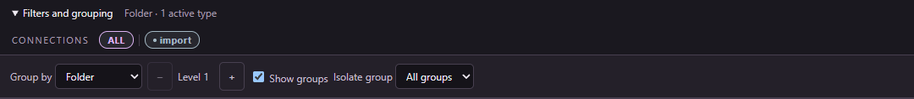
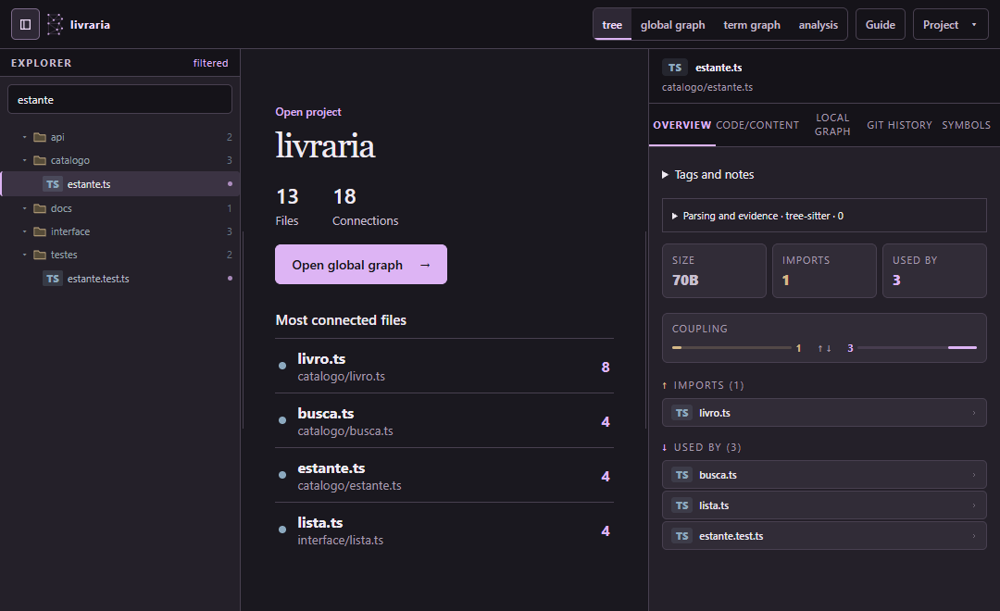
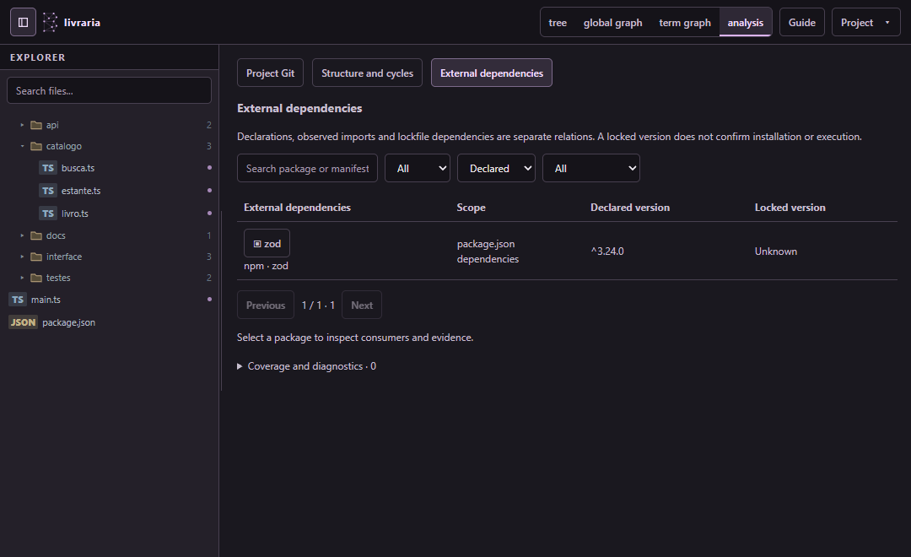
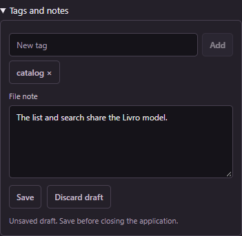
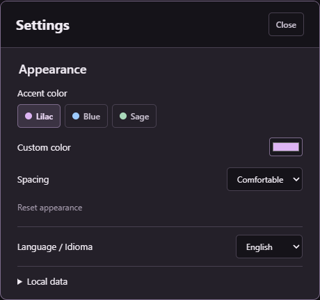
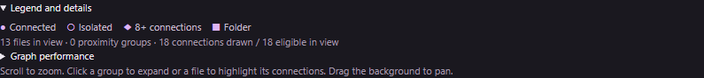

# BeckaRepo Illustrated User Manual

Screenshots follow a TypeScript bookstore catalog analyzed in BeckaRepo. Open your own project and repeat these steps with the files found in your repository. Inside the in-app **Guide**, click any screenshot to enlarge it.

- [Getting started](#getting-started)
- [Reading the galaxy](#reading-the-galaxy)
- [Layouts and groups](#layouts-and-groups)
- [Navigation and filters](#navigation-and-filters)
- [Search and file panel](#search-and-file-panel)
- [Analysis](#analysis)
- [Notes, data and export](#notes-data-and-export)
- [Customize the interface](#customize-the-interface)
- [Troubleshooting](#troubleshooting)

## Getting started

**Open a project and follow a connection**

Start with the folder containing the source files. The map describes relationships within the selected project.

### Open a folder

Choose **Select folder** in the desktop app or drag your project directory onto the window. The app inventories files, maps references, checks revisions, and transfers the result. Cancel is available during loading.

### Find a starting point

On the project page, select one of the most connected files to open its panel. Expand a directory in the tree or use **Search files** to find a name or path. Select a file to open its panel. Open the global graph to explore the whole project.

On the `livraria` project page, select `livro.ts` from the list to inspect it, or open the global graph to locate it in the project.

### Follow one link

Choose **Files** and **Galaxy**. Select a file in the tree, use **Locate selected**, and set **Connections** to **File only**. Select a neighbor to continue exploring.

## Reading the galaxy

**Read the marks on the map**

A node represents a file. A line represents a relationship detected during analysis. Positions depend on your filters and layout.

### Core and outer ring

**Galaxy** counts two points per distinct incoming neighbor and one per outgoing neighbor. More connected files sit closer to the center. Isolated files occupy the outer ring. A critical file can appear at the edge when its links go undetected.

Find `livro.ts` near the middle of the bookstore map and compare its neighbors with the files near the edge.

### Relation types

An import starts at the file that uses a dependency. A reference can indicate a path mentioned in text. Projects with prototypes or RSI resources may also link definitions, sprites, and states. Open **Filters and grouping** to inspect one type at a time.

### Shapes and colors

A filled circle is a connected file. An outline marks a file without connections in the current filter. A diamond indicates eight or more connections. Color helps distinguish file types. In **Folders**, select a square to open a directory.

## Layouts and groups

**Choose the scale of your investigation**

**Detail** chooses what a node represents. **Layout** controls where it appears.

### Galaxy, Atlas and Free

Choose **Galaxy** to find highly connected files. **Atlas** places groups in blocks sized by file count, with files ordered by path. **Free** uses a force simulation to bring linked files together. **Classic** provides an SVG view for up to 800 nodes.

The same catalog in **Atlas**. Compare the space allocated to each group, then switch back to **Galaxy** to inspect links.

### Group or isolate

Open **Filters and grouping**. Group by folder, architecture, module, or type. Folder depth chooses a directory level. Architecture uses patterns in paths. Modules use connections. Use the isolation selector to inspect one group and select the entire graph to return.

### Open folders on the map

Choose **Folders** to collapse directories. Select a square or use the folder list to expand it. A selected file stays separate. Each line counts relationships of the same type between representatives. Internal relationships appear in the folder count.

In **Folders**, a square represents the files in a directory. Select it to reveal its contents while other directories stay collapsed.

## Navigation and filters

**Follow a link in a dense map**

Zoom into a region before increasing the number of lines.

### Move and fit

Scroll to zoom and drag the background to pan. **Fit all** restores the overview. With the canvas focused, use `+` and `−` to zoom, arrow keys to pan, `Home` to fit, and `Escape` to clear the selection. Drag a file to pin it and double-click to release it.

### Choose connections

Type filters determine which relationships enter the map. **Automatic** limits overview lines. **File only** focuses on a selected file. **All** raises the drawing limit to 12,000 lines. The counters distinguish drawn lines from eligible lines in the viewport. Open **Legend and details** at the bottom to read these counters.

With `livro.ts` selected and **File only** active, follow a line to a consumer. Clear the selection to choose another starting point.

### When dots merge

Overview density dots combine nearby files on screen. Hover for a count or click to zoom. For a particular file, select it in the tree and use **Locate selected**.

Open **Filters and grouping**. The first control chooses relation types. **Group by** and **Isolate group** change how the files are organized and displayed.

## Search and file panel

**Inspect content and neighbors**

**Search files** above the tree filters names and paths. In the term graph tab, **Search content** looks for text inside files.

### Search text

Enter at least two characters in the content search. Results appear with neighbors for context. Check how many files were searched, skipped, or changed. Load another page when available.

### Inspect a file

Use the file panel for an overview, code or preview, and the local graph. The first hop contains immediate neighbors. The second goes one step further. Preview availability depends on the file format, size, and revision.

Searching for `estante` finds both the file and its test. Select `estante.ts` and check its path at the top of the panel before opening the code.

### Symbols and history

**Symbols** shows details recognized for supported languages. **History** uses the local Git repository and available commits. Refresh the analysis if the file has changed on disk.

## Analysis

**Investigate structure and history**

Open the analysis view for questions that a node's position alone cannot answer.

### Structure

Use centrality and cycle reports to choose a region to investigate. A cycle follows links back to its starting point. Open the files and check the evidence before planning a change.

### Git

Change the time window to explore change frequency and files modified in the same commits. Coverage depends on local history. Co-change can suggest a maintenance relationship even without a direct import.

### External dependencies

Inspect packages recognized in npm, Cargo, and Maven manifests. Filter by ecosystem and examine consumers, declarations, and evidence. Read diagnostics when versions or resolution information are missing.

Under **External dependencies**, find `zod` and check its manifest and declared version. Select the name to investigate its consumers.

## Notes, data and export

**Keep a record of your investigation**

Write notes on a file and use tags to track related topics.

### Save an annotation

Select a file, expand **Tags and notes** in the file panel, edit the text or tags, and save. The local SQLite database associates annotations with the worktree and path. Resolve pending drafts before switching projects.

Enter a tag and select **Add**. Write the note, then save the draft shown here.

### Import notes or move a project

With the target project open, data settings can import JSON notes by relative path and preserve existing annotations. Each import accepts up to 2,000 entries and 4 MiB. If you moved the folder, check the previous location before reassociating it.

### Export or back up

**Project → Export** writes the folder and file structure to Markdown. Open **Project → Settings and data → Local data** to create or restore a backup. Restoring replaces the local database with the selected backup. Check the file before confirming.

## Customize the interface

**Adjust the workspace to your screen**

Open **Settings and data** on the start screen. With a repository open, find the same window in the **Project** menu.

### Choose a color

Under **Appearance**, try Lilac, Blue, or Sage. For another hue, select the **Custom color** swatch to open the system picker. Check the active tab and graph selection. Dark colors are lightened to keep labels readable.

The swatch shows your chosen color. **Spacing** below it adjusts the height of rows and controls.

### Fit more files in the tree

Choose **Compact** under **Spacing** for shorter explorer rows and map controls. Choose **Comfortable** for larger click targets. Use the explorer button at the left of the toolbar to fold the tree when you need horizontal space.

### Restore the defaults

**Reset appearance** restores lilac and comfortable spacing. The desktop app saves preferences in its local database so they return on launch. Restoring a backup also restores the preferences saved in that database.

## Troubleshooting

**When the result is unexpected**

Use the tree and counters to distinguish a navigation issue from a limitation of analysis.

### A file is in the tree but missing from the map

Switch to **Files**, clear isolation, and fit the entire graph. Select its path in the tree and use **Locate selected**. Enable the relevant connection types if the file appears isolated.

### An expected link is missing

Check the type filters and drawing mode, then inspect the code. Dynamic references, partially supported languages, and ambiguous paths can leave links unresolved.

Expand **Legend and details**. Compare drawn links with the eligible links in the viewport before concluding a connection is missing.

### Opening takes a long time

Check the current loading stage. **Project → Refresh** reuses valid results from the current session and checks changes on disk. After loading, **Legend and details → Graph performance** reports drawing cost. Use **Folders** or **File only** to reduce visible detail.
