# Manual ilustrado do BeckaRepo

As capturas acompanham um catálogo de livros em TypeScript analisado pelo BeckaRepo. Abra o seu projeto e repita os passos com os caminhos encontrados nele. No Guia do aplicativo, clique em qualquer captura para ampliá-la.

- [Primeiros passos](#primeiros-passos)
- [Ler a galáxia](#ler-a-galáxia)
- [Disposições e grupos](#disposições-e-grupos)
- [Navegação e filtros](#navegação-e-filtros)
- [Busca e painel do arquivo](#busca-e-painel-do-arquivo)
- [Análises](#análises)
- [Notas, dados e exportação](#notas-dados-e-exportação)
- [Personalizar a interface](#personalizar-a-interface)
- [Resolver dúvidas](#resolver-dúvidas)

## Primeiros passos

**Abra um projeto e siga uma conexão**

Comece pela pasta que contém o código. O primeiro mapa mostra como os arquivos dessa pasta se relacionam.

### Abrir a pasta

Na janela do BeckaRepo, escolha Selecionar pasta ou arraste o diretório do projeto para a janela. Durante a abertura, o aplicativo inventaria arquivos, mapeia referências, confere revisões e transfere o resultado. Você pode cancelar pela tela de progresso.

### Encontrar um ponto de partida

Na página do projeto, clique em um dos arquivos com mais conexões para abrir seu painel. Na árvore, abra uma pasta ou use Buscar arquivo para localizar um nome ou caminho. Selecione o arquivo para abrir seu painel. Para comparar o projeto inteiro, abra o grafo global.

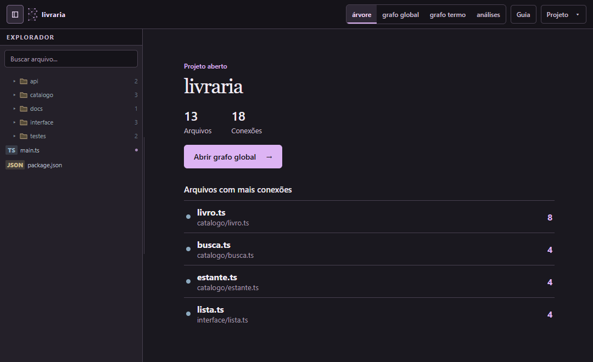

Na página da livraria, escolha livro.ts na lista para abrir seu painel, ou Abrir grafo global para situá-lo no projeto.

### Seguir a primeira ligação

No grafo global, use Arquivos e Galáxia. Selecione um arquivo na árvore, clique em Localizar selecionado e escolha Só do arquivo em Conexões. Clique em um vizinho para continuar o percurso.

## Ler a galáxia

**O que você vê no mapa**

Cada arquivo é um nó. Cada linha representa uma relação identificada na análise. A posição muda conforme os filtros e a disposição escolhida.

### Centro e periferia

Na Galáxia, cada vizinho distinto que aponta para um arquivo vale dois pontos. Cada vizinho para o qual ele aponta vale um. Arquivos mais conectados ocupam o centro. Os isolados ficam na faixa externa. Um arquivo essencial pode estar na periferia se suas relações não forem detectadas.

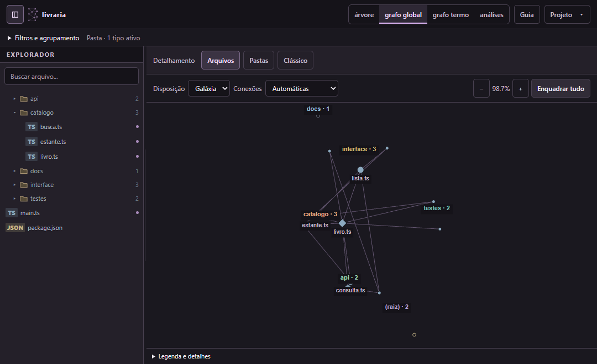

No mapa da livraria, procure livro.ts na região central e compare sua vizinhança com a dos arquivos na borda.

### Tipos de relação

Uma importação parte do arquivo que usa a dependência. Uma referência pode indicar um caminho mencionado no texto. Projetos com protótipos ou recursos RSI podem apresentar ligações entre definições, sprites e estados. Abra Filtros e agrupamento para examinar um tipo por vez.

### Formas e cores

Em Arquivos, o círculo cheio indica um arquivo conectado. O vazado indica ausência de conexões no filtro atual. O losango marca oito ou mais conexões. As cores ajudam a distinguir tipos de arquivo. Em Pastas, um quadrado abre um diretório.

## Disposições e grupos

**Escolha a escala da investigação**

Detalhamento escolhe o que um nó representa. Disposição escolhe onde cada nó aparece.

### Galáxia, Atlas e Livre

Use Galáxia para encontrar centros de conectividade. Use Atlas para comparar grupos em blocos proporcionais ao número de arquivos e ordenados internamente por caminho. Livre aproxima arquivos ligados por uma simulação de forças. Até 800 nós, Clássico oferece a visualização em SVG.

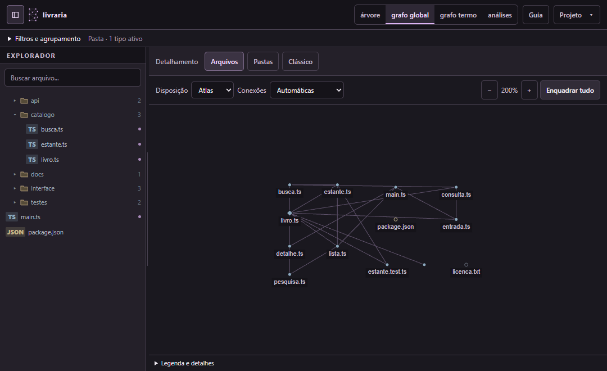

O mesmo catálogo em Atlas. Compare o espaço ocupado por cada grupo e depois retorne a Galáxia para examinar as ligações.

### Agrupar ou isolar

Abra Filtros e agrupamento. Agrupe por pasta, arquitetura, módulos ou tipo. A profundidade de pasta muda o nível de diretório usado. Arquitetura usa padrões nos caminhos e Módulos usa as conexões. Use o seletor de isolamento para explorar um grupo e volte à opção de ver todo o grafo para sair.

### Abrir pastas no mapa

Escolha Pastas para condensar diretórios. Clique em um quadrado ou abra a lista de pastas para expandir um diretório. O arquivo selecionado permanece separado. O número de uma linha soma as relações do mesmo tipo entre os representantes. As relações internas aparecem na contagem da pasta.

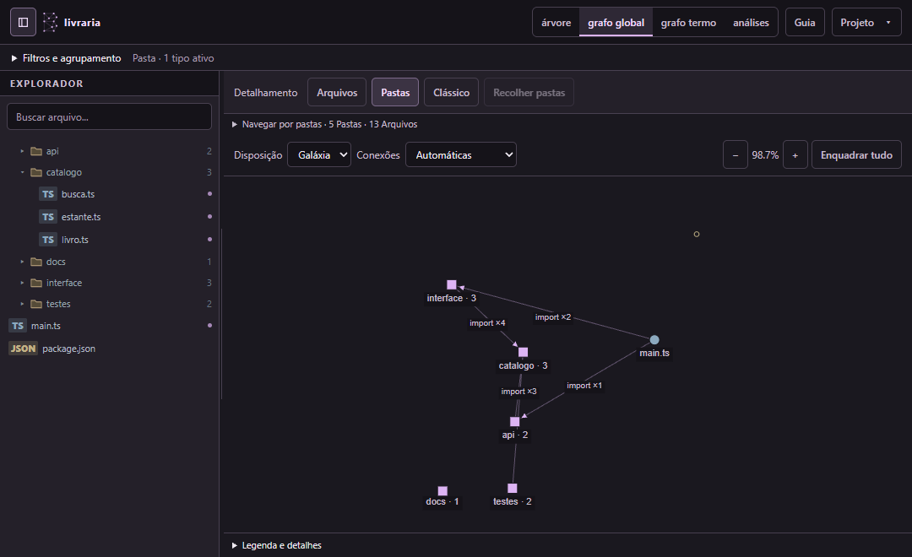

Em Pastas, um quadrado reúne arquivos de um diretório. Clique nele para revelar o conteúdo mantendo os demais diretórios recolhidos.

## Navegação e filtros

**Leia uma ligação em um mapa denso**

Aproxime a região de interesse antes de aumentar o número de linhas.

### Mover e enquadrar

Role para aproximar e arraste o fundo para navegar. Enquadrar tudo recupera a visão geral. Com o canvas em foco, use + e − para zoom, setas para mover, Home para enquadrar e Escape para limpar a seleção. Arrastar um arquivo fixa sua posição. Um duplo clique solta o arquivo.

### Escolher as conexões

Os filtros de tipo escolhem quais relações entram no mapa. Automáticas limita o desenho na visão geral. Só do arquivo concentra as linhas na seleção. Todas amplia o limite de desenho para até 12 mil linhas. Os contadores distinguem linhas desenhadas e elegíveis na área. Abra Legenda e detalhes no rodapé para consultar esses números.

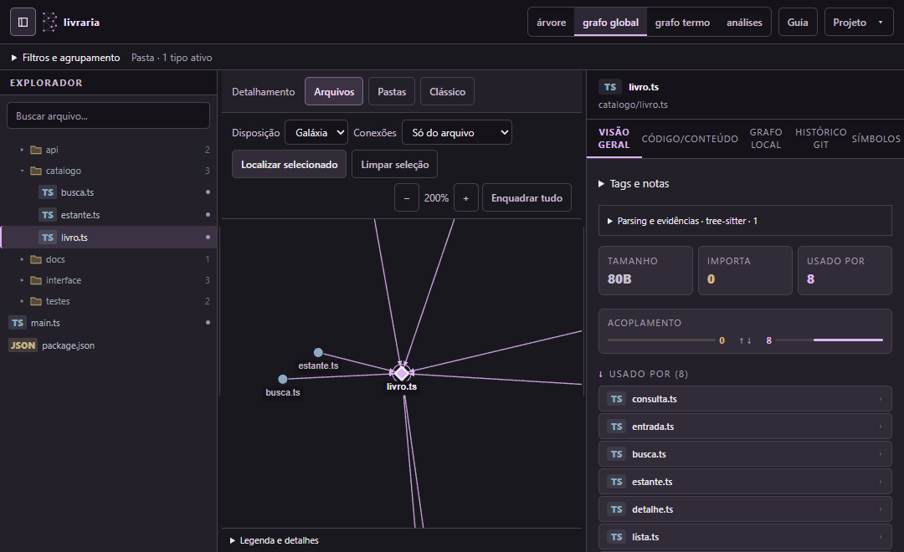

Com livro.ts selecionado e Só do arquivo ativo, siga uma linha até um consumidor. Limpar seleção permite escolher outro ponto de partida.

### Quando os pontos se juntam

Na visão geral, pontos de densidade reúnem arquivos próximos na tela. Passe o cursor para consultar a quantidade ou clique para aproximar. Para chegar a um arquivo específico, selecione-o pela árvore e use Localizar selecionado.

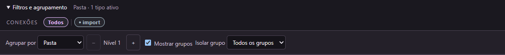

Abra Filtros e agrupamento. O primeiro controle escolhe relações; Agrupar por e Isolar grupo mudam como o conjunto é organizado e exibido.

## Busca e painel do arquivo

**Investigue o conteúdo e a vizinhança**

Buscar arquivo fica acima da árvore e filtra nomes e caminhos. Na aba grafo termo, Buscar no conteúdo procura texto dentro dos arquivos.

### Pesquisar texto

Digite ao menos dois caracteres na busca de conteúdo. Os resultados aparecem com seus vizinhos de contexto. Confira quantos arquivos foram pesquisados, ignorados ou alterados. Quando disponível, carregue a próxima página.

### Inspecionar um arquivo

Use o painel para consultar o resumo, abrir o código ou a prévia e explorar o grafo local. O primeiro nível reúne vizinhos diretos. O segundo ajuda a seguir um passo além. A prévia depende do formato, tamanho e revisão do arquivo.

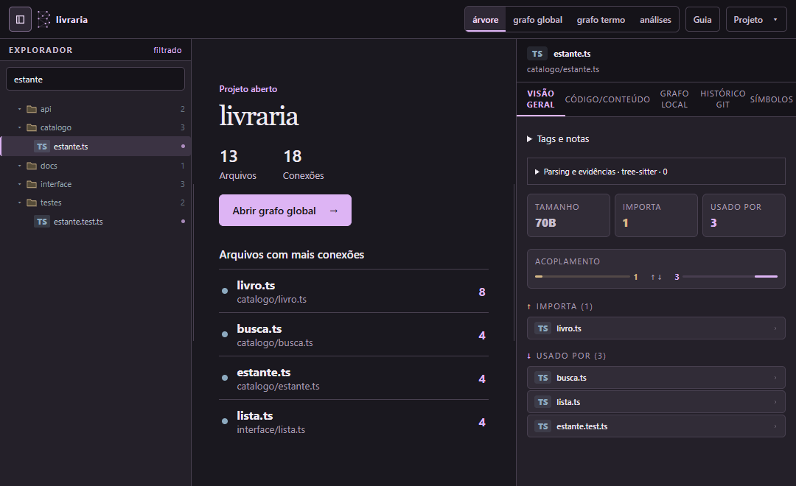

A consulta estante localiza o arquivo e seu teste. Selecione estante.ts e confira o caminho no topo do painel antes de abrir o código.

### Símbolos e histórico

Símbolos apresenta informações reconhecidas pelo analisador para linguagens compatíveis. Histórico depende de um repositório Git e dos commits disponíveis. Se um arquivo mudou no disco desde a abertura, atualize a análise antes de consultar a nova versão.

## Análises

**Investigue a estrutura e o histórico**

Abra análises para responder perguntas que a posição dos nós, sozinha, não resolve.

### Estrutura

Consulte centralidade e ciclos para escolher um trecho a investigar. Um ciclo liga arquivos por um percurso que volta ao ponto de partida. Abra os arquivos envolvidos e confira as evidências antes de planejar uma mudança.

### Git

Altere a janela de tempo para investigar frequência de alterações e arquivos que costumam mudar no mesmo commit. A cobertura depende do histórico local. Uma mudança conjunta é uma pista de manutenção, mesmo quando os arquivos não têm uma importação direta.

### Dependências externas

Consulte os pacotes reconhecidos nos manifests npm, Cargo e Maven. Filtre o ecossistema e examine consumidores, declarações e evidências. Leia os diagnósticos quando faltar informação de versão ou de resolução.

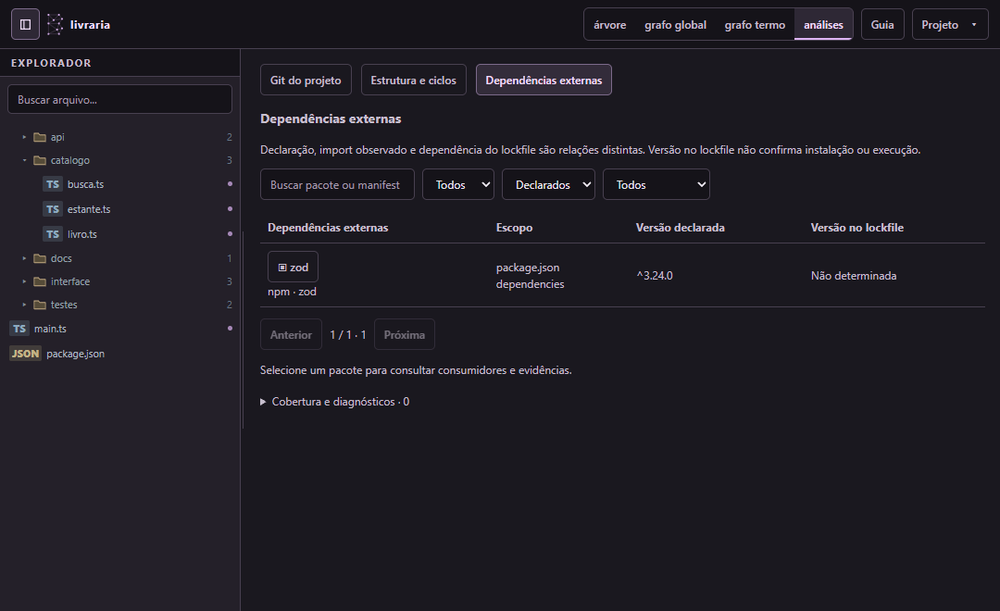

Em Dependências externas, localize zod e confira o manifest e a versão declarada. Clique no nome para investigar os arquivos consumidores.

## Notas, dados e exportação

**Guarde o contexto da investigação**

Use notas para registrar o que descobriu sobre um arquivo e tags para reencontrar assuntos relacionados.

### Salvar uma anotação

Selecione o arquivo, abra Tags e notas no painel, edite o texto ou as tags e salve. Os dados ficam no SQLite local e são associados à cópia de trabalho e ao caminho. Resolva os rascunhos pendentes antes de trocar de projeto.

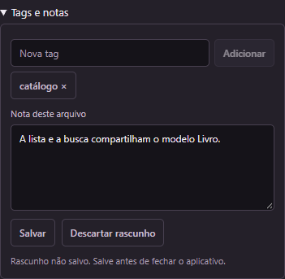

Digite a tag e clique em Adicionar. Escreva a observação e clique em Salvar para guardar a edição que aparece na figura.

### Importar notas ou mover o projeto

Com o projeto de destino aberto, Configurações e dados permite importar notas JSON por caminho relativo, preservando anotações existentes. Cada importação aceita até 2.000 entradas e 4 MiB. Se você moveu a pasta, confira a localização anterior antes de reassociá-la.

### Exportar ou fazer backup

Projeto → Exportar gera um Markdown da estrutura de pastas e arquivos. Em Projeto → Configurações e dados, abra Dados locais para criar ou restaurar um backup. A restauração substitui o banco local pelo backup escolhido. Confira o arquivo antes de confirmar.

## Personalizar a interface

**Ajuste a leitura ao seu monitor**

Na tela inicial, abra Configurações e dados. Com um repositório aberto, a mesma janela fica no menu Projeto.

### Escolher uma cor

Em Aparência, experimente Lilás, Azul ou Sálvia. Para usar outra tonalidade, clique na amostra de Cor personalizada e escolha a cor no seletor do sistema. Confira a mudança na aba ativa e na seleção do grafo. Tons escuros ganham luminosidade para manter o texto legível.

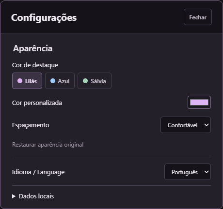

A amostra mostra a cor escolhida. O controle de espaçamento logo abaixo ajusta o tamanho das linhas e dos controles.

### Ver mais arquivos na árvore

Em Espaçamento, escolha Compacto para reduzir a altura das linhas do explorador e dos controles do mapa. Volte a Confortável para aumentar a área de clique. O botão do explorador à esquerda da barra recolhe a árvore quando você precisa de mais espaço horizontal.

### Recuperar o padrão

Restaurar aparência original repõe o lilás e o espaçamento confortável. As preferências do aplicativo desktop ficam no banco local e voltam ao abrir o BeckaRepo. A restauração de um backup também recupera as preferências daquele banco.

## Resolver dúvidas

**Quando o resultado surpreende**

Use a árvore e os contadores para distinguir um problema de navegação de uma limitação da análise.

### O arquivo está na árvore, mas não o vejo no mapa

Volte a Arquivos, remova o isolamento e enquadre tudo. Selecione o caminho pela árvore e use Localizar selecionado. Reative os tipos de conexão relevantes se o arquivo aparecer isolado.

### Uma relação esperada não aparece

Confirme primeiro o filtro de tipos e o modo de desenho. Depois confira o código. Referências dinâmicas, linguagens parcialmente suportadas e caminhos ambíguos podem deixar relações sem resolução.

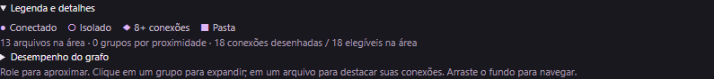

Expanda Legenda e detalhes. Compare as conexões desenhadas com as elegíveis na área antes de concluir que uma ligação está ausente.

### A abertura está demorada

Observe a etapa de progresso. Projeto → Atualizar reaproveita resultados válidos da sessão e reconcilia mudanças no disco. Depois da abertura, Legenda e detalhes → Desempenho do grafo informa o custo do desenho. Em mapas densos, use Pastas ou Só do arquivo para reduzir a quantidade de elementos visíveis.
