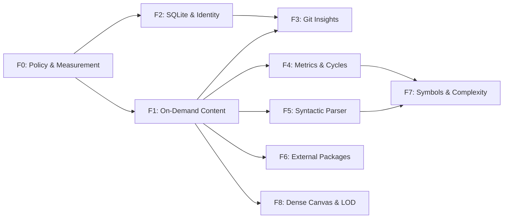

# Technical Roadmap — BeckaRepo

Architectural roadmap guiding the evolution of BeckaRepo from a basic file-dependency graph into a native local architecture, history, and dependency-intelligence workstation. All features operate offline with zero code execution or network calls.

For implementation details per phase, see [ETAPA_F1.md](ETAPA_F1.md) through [ETAPA_F8.md](ETAPA_F8.md) and the [README](../README.md).

## Architectural Principles & Trade-offs

| Assumption / Design Question | Decision & Reality |
| --- | --- |
| Desktop runtime | Replaced Electron/Node with **Tauri 2 + Rust**, reducing the Windows installer from 75.9 MB to ~4.98 MB and enforcing session/path controls in native code. |
| Regex backtracking (ReDoS) | The native parser uses Rust's `regex` crate, which provides linear-time `O(m·n)` matching. Per-file size limits, match budgets, and cancellation still apply. JS regex remains only in UI syntax highlighting. |
| Tree-sitter vs. compiler semantics | Tree-sitter produces concrete syntax trees; module resolution, `tsconfig`/Cargo lookups, scopes, and symbol calls require explicit resolver logic and are bounded heuristics rather than full compiler checks. |
| Zero inbound edges = dead code | Absence of detected incoming edges is only a coverage hint — dynamic imports, callbacks, reflection, routes, and external entrypoints prevent automatic dead-code claims. |
| Churn / centrality as risk proof | Git churn, PageRank, and betweenness are investigation signals shown with explicit formulas, time windows, and coverage limits — never automated bug scores or developer productivity rankings. |
| Arbitrary source chunking | Imports and tokens can cross chunk boundaries, so files are loaded individually under a 500 KiB limit, indexed into compact metadata, and immediately discarded from memory. |
| GPU / Wasm for 100k nodes | Layout and rendering costs are profiled separately (scan, IPC, Worker physics, Canvas draw) before committing to WebGPU or Wasm ports; CPU Web Worker physics + spatial clustering already handle 85k+ files. |
| SQLite safety | Transactions protect writes, complemented by consistent SQLite `backup` API snapshots, 5-slot rotation, validation on restore, and recovery folders for corrupted files. |
| Filename allow/deny lists | Blocking `.env` and credential filenames prevents accidental reads, though it cannot scrub secrets embedded inside ordinary source files or OS memory. |

## Current State

All core phases **F0 through F8** have working implementations across `crates/beckarepo-core/`, `src-tauri/src/`, and `src/`:

- **Native Core (`crates/beckarepo-core/`):** `repository.rs`, `parser.rs`, `analysis.rs`, `syntax.rs`, `web_resolution.rs`, `cargo_resolution.rs`, `rust_modules.rs`, `packages.rs`, `symbols.rs`, and `policy.rs`, plus the standalone `beckarepo-cli` binary.
- **Desktop Host (`src-tauri/src/`):** Session confinement, drag-and-drop root authorization, 28 Tauri IPC commands, batched snapshot transport (256 items / 256 KiB per batch), media preview (`read_asset`), Markdown export, SQLite storage, Git adapter, and structural graph analytics.
- **Incremental Pipeline (F1):** Source-free v2 snapshots (keeping the v1 graph contract), on-demand file reading, paginated native Rust literal search with cooperative cancellation, and manual incremental refresh reusing unchanged relations.
- **SQLite Persistence (F2):** Bundled `rusqlite 0.38` (`beckarepo.sqlite` in OS local app data), language and panel preferences, worktree-scoped tags and notes, idempotent `localStorage`/JSON import, consistent backup/restore, and explicit folder reassociation.
- **Git Integration (F3):** Read-only per-file Git history, linked worktree detection, byte comparison against index, project-wide hotspots, optional `.mailmap` authorship, co-change tables with visual graph overlay, and regenerable SQLite cache. See [ETAPA_F3.md](ETAPA_F3.md).
- **Structural Metrics (F4):** Iterative Kosaraju strongly connected components with cycle witness paths, in/out degree, PageRank, and exact/sampled Brandes betweenness centrality computed in Rust with a 30 s budget. See [ETAPA_F4.md](ETAPA_F4.md).
- **Syntactic Parsing & Resolution (F5):** Tree-sitter grammars for JS/JSX/TS/TSX and Rust, byte-range evidence, `tsconfig`/`jsconfig` (`paths`, `baseUrl`, `extends`), Cargo targets/workspaces/`workspace.dependencies`, logical Rust module trees, and literal `#[path]` attributes. See [ETAPA_F5.md](ETAPA_F5.md).
- **External Packages (F6):** Offline npm, Cargo, and Maven manifest/lockfile parsing with declared vs. resolved versions, direct consumer evidence, and indirect impact queries. See [ETAPA_F6.md](ETAPA_F6.md).
- **Symbols & Complexity (F7):** On-demand per-file Tree-sitter symbol extraction, Decisions v1 cyclomatic complexity, and conservative intra-file lexical call graphs. See [ETAPA_F7.md](ETAPA_F7.md).
- **Dense Visualization & Layouts (F8):** **Galaxy**, **Atlas**, **Free** (Web Worker force physics), and **Classic** (SVG ≤ 800 nodes) layouts; **Dense Canvas** for > 800 nodes with spatial clustering, explicit edge budgets (1,200 / 5,000 / 12,000), and **Folder** drill-down mode. Verified end-to-end on an 85,224-file / 91,744-edge dataset ([2026-11-25 Graph Report](validation/2026-11-25/RELATORIO_GRAFO.md)). See [ETAPA_F8.md](ETAPA_F8.md).

## Delivery Graph & Milestones

| Phase | Deliverable | Dependencies | Completion Criteria |
| --- | --- | --- | --- |
| **F0** | File policy, limits, diagnostics baseline | Baseline | Budgets enforced on every path; boundary cases covered; scan/IPC/layout timings separated. |
| **F1** | Incremental pipeline & on-demand content | F0 | Source-free desktop snapshots; native search & previews; bounded read buffers. |
| **F2** | SQLite & persistent identity | F0 + F1 | Tags/notes/preferences survive restarts; transactional migrations, backup & restore. |
| **F3** | Git history, churn, hotspots & co-change | F1 + F2 | Reproducible commit/window results; cancellation, cache & non-Git fallback. |
| **F4** | Cycles & structural metrics | F1 | Explainable cycle witness paths; documented universe, direction & approximations. |
| **F5** | Tree-sitter & per-language resolution | F1 + v2 | JS/TS & Rust pilot with byte-range evidence, labeled fallbacks & corpus checks. |
| **F6** | External package dependencies | F1 + v2 (+ F5) | Distinguishes declared, resolved & imported packages; impact queries show evidence. |
| **F7** | Symbols, complexity & intra-file zoom | F5 + F4 | On-demand expansion preserving selection; function complexity; conservative call edges. |
| **F8** | Hierarchical LOD & off-thread layout | F1 (+ F7) | Dense navigation preserves camera/selection; Worker physics; folder drill-down. |

## Phase Status & Remaining Backlog

### F0 — Policy & Limits
- [x] `policy.rs` shared exclusions, sensitive-filename blocking before reads, canonical root confinement, and strict UTF-8 byte caps.
- [ ] **SEC-02:** Enforce explicit upper-bound diagnostics across all remaining symbol, edge, and queue structures without silent truncation.
- [ ] **SEC-03:** Structured command/error DTOs and tightened Tauri capability permissions.
- [ ] **SEC-04:** Backend-driven Markdown export with name escaping and scope preview.
- [ ] **OBS-01:** Structured per-stage timing, IPC byte counters, and exclusion summaries without logging sensitive values.
- [ ] **VAL-01:** Expand edge-case coverage for remaining aggregate caps and concurrent filesystem changes (core boundary suite passing since 2026-10-27).

### F1 — Memory & On-Demand Content (Implemented)
- [x] **MEM-01:** Two-pass scanner with compact path/YAML/RSI index; reads and discards one file at a time.
- [x] **MEM-02:** Source-free v2 snapshots while preserving v1 `--json` CLI compatibility.
- [x] **MEM-03:** Session-authorized, revision-checked `read_file_content` and `read_asset` with no global source cache.
- [x] **MEM-04:** Native paginated, cancelable Rust text search (`search_repository`) with coverage counters.
- [x] **MEM-05:** Batched IPC (`256 items / 256 KiB`), sequential cursors, atomic publish (`finish_snapshot`), and `analysisId` cancellation.
- [x] **MEM-06:** Pre/post-read revision verification (up to 3 retries on disk churn) and incremental manual refresh.

### F2 — Local Persistence (Implemented)
- [x] **DB-01:** Bundled `rusqlite 0.38` database stored strictly outside analyzed repositories.
- [x] **DB-02:** Versioned transactional migrations separating repository, worktree, and path location identities.
- [x] **DB-03:** Separation of persistent annotations/preferences from regenerable caches.
- [x] **DB-04:** Idempotent import from legacy `localStorage` and JSON export files.
- [x] **DB-05:** Consistent SQLite backups (5-slot rotation), verified restore, and corrupted-DB recovery directories.
- [x] **DB-06:** Draft protection, conflict detection, and explicit moved-folder reassociation.
- [ ] Orphaned annotation viewer for deleted files and clean-machine installer validation.

### F3 — Git History & Insights (Implemented)
- [x] **GIT-01:** Root/worktree discovery distinguishing `HEAD`, index, and working-tree byte state.
- [x] **GIT-02 / GIT-03:** Read-only `std::process::Command` Git adapter (`--numstat`, `-z`, no shell/hooks/remote protocols) with 30 s timeout and cancellation.
- [x] **GIT-04:** Persistent SQLite `git_cache` keyed by worktree, scope, HEAD, window, and `shallow` hash.
- [x] **GIT-05 / GIT-06:** Paginated project hotspots (visible weighted formula) and optional `.mailmap` authorship.
- [x] **GIT-07:** Co-change pair analysis with configurable support/mass-commit limits and dashed graph overlay.
- [ ] Global historical rename unification across project-wide queries and explicit deleted-file classification.

### F4 — Architectural Metrics (Implemented)
- [x] **MET-01 / MET-02:** Directed structural projection (`import`, `require`, `re-export`, optional `prototype-parent`) with iterative Kosaraju SCC cycles and closed witness paths.
- [x] **MET-03 / MET-04:** Paginated in/out degree, PageRank (`0.85` damping, `1e-8` L1 tolerance), and Brandes betweenness centrality (exact ≤ 256 sources, deterministic sampling above).
- [x] **MET-05:** Side-by-side structural and Git hotspot evidence without synthetic risk scores.
- [ ] External reference-benchmark cross-check (e.g., NetworkX numerical parity).

### F5 — Syntactic Parsing & Resolution (Core Pilot Implemented)
- [x] **AST-01 / AST-02:** Language-agnostic fact extraction (`syntax.rs`) with Tree-sitter grammars for JS/JSX/TS/TSX and Rust, retaining YAML/RSI heuristics.
- [x] **AST-03 (Partial):** Byte-range bindings, `tsconfig`/`jsconfig` resolution (`paths`, `baseUrl`, `extends`), Cargo targets/workspaces, logical Rust module trees, and literal `#[path]` attributes. *Remaining:* full TS project `references`, `cfg`/feature evaluation, macros, and cross-file re-export/symbol resolution.
- [x] **AST-04:** Labeled `regex-fallback` and syntax/unresolved-import diagnostics in **Parsing & Evidence**.
- [ ] **AST-05:** Expanded multi-language corpus precision/recall benchmarks.

### F6 — External Dependencies (Implemented for npm / Cargo / Maven)
- [x] **EXT-01 – EXT-04:** Offline readers for `package.json`, `package-lock.json` v2/v3, `npm-shrinkwrap.json`, `Cargo.toml`, `Cargo.lock` v3/v4, and direct `pom.xml` dependencies, with consumer evidence, indirect impact queries, and paginated UI.
- [ ] Full Yarn/pnpm lockfile parsing, Maven BOM/profiles/property interpolation, and Java import-to-artifact resolution.

### F7 — Symbols & Intra-File Navigation (Pilot Implemented)
- [x] **SYM-01 / SYM-02 / SYM-04 / SYM-05:** On-demand Tree-sitter symbol extraction, revision-bound identities, expandable 40-symbol/80-edge view, Decisions v1 complexity scoring, and conservative entrypoint/unused hints.
- [x] **SYM-03 (Partial):** Conservative lexical intra-file call resolution. *Remaining:* cross-file symbol resolution, type inference, and method dispatch tracking.

### F8 — Visualization & Scale (Dense Canvas, Worker Physics & Folders Implemented)
- [x] **VIS-01 (Partial):** Force physics offloaded to a Web Worker (`denseLayoutRuntime.js`), with compute/apply/draw timings and 85k-file benchmark runs. *Remaining:* p50/p95 WebView frame telemetry and off-thread simulation for small SVG/local graphs.
- [x] **VIS-02:** Explicit **Folder** drill-down projection with progressive expansion, aggregated edge multiplicities, and individual selected-file preservation.
- [x] **VIS-03 (Partial):** Spatial clustering hysteresis (`3,000 → 2,000`), CSS-pixel sizing, explicit connection budgets, and deterministic **Galaxy** / **Atlas** layouts. *Remaining:* automatic zoom-driven LOD thresholds and view/snapshot state persistence.
- [ ] **VIS-04:** Comparative WebGPU / Rust-Wasm layout experiment.
- [ ] **VIS-05:** Accessibility refinements for heatmaps, reduced motion, and non-color indicators.

## Future Horizon (Post-v2.0)

- Cross-file symbol resolution and global call graphs
- Automatic zoom-level LOD expansion with hysteresis
- Full Rust `cfg` / feature-flag evaluation and TypeScript project references
- AI-assisted architecture insights and dependency risk analysis
- Multi-repository workspace visualization
- Live filesystem watching and collaborative annotations

## Validation History

- [2026-10-27 — Automated F0–F5 Suite](validation/2026-10-27/RELATORIO_F0_F5.md)
- [2026-10-28 — Native Visual Validation](validation/2026-10-28/VALIDACAO_VISUAL.md)
- [2026-10-29 — F5 Rust `#[path]` Attributes](validation/2026-10-29/RELATORIO_F5_PATH.md)
- [2026-10-30 — F6 Packages & F7 Symbols Pilot](validation/2026-10-30/RELATORIO_F6_F7.md)
- [2026-10-30 — F8 Canvas Worker Physics](validation/2026-10-30/RELATORIO_F8_WORKER.md)
- [2026-10-31 — F8 Folder Drill-Down](validation/2026-10-31/RELATORIO_F8_PASTAS.md)
- [2026-11-25 — Gaby-CMU 85k-File Benchmark & Layouts](validation/2026-11-25/RELATORIO_GRAFO.md)
