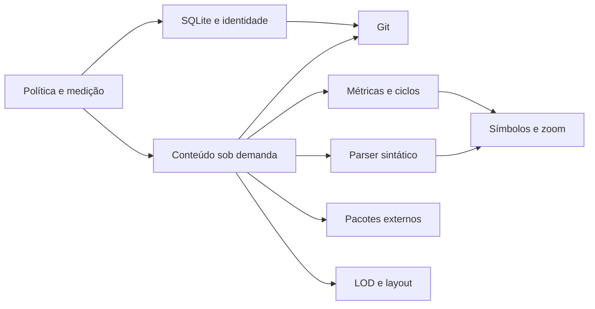

# Roadmap técnico — BeckaRepo

Baseado nos dois briefings fornecidos em 25/10/2026. Este documento é a referência atual de evolução; o diagnóstico anterior à migração continua como histórico.

## Objetivo

Evoluir de um grafo de arquivos para uma ferramenta local de análise arquitetural com histórico, evidências e navegação progressiva. Manter operação offline, interface discreta e controle do usuário sobre seus dados.

**Escopo desta preparação:** reconciliar o briefing com o código atual, definir entregas implementáveis e iniciar a política compartilhada de seleção/limites. As funcionalidades futuras abaixo não estão disponíveis só por constarem no roadmap.

## Ajustes ao briefing

| Premissa | Situação e decisão |
| --- | --- |
| Electron/Node como host | Já substituídos por Rust/Tauri. Hardening e persistência serão implementados no host Rust. |
| ReDoS por backtracking do V8 no parser | O parser usa a crate Rust `regex`. Ela oferece busca com limite O(m·n); iteração sobre matches pode ter custo maior. Continuam necessários limites, cancelamento e medição. Regex JavaScript ainda existe no destaque de código. [Referência](https://docs.rs/regex/latest/regex/#untrusted-input). |
| Tree-sitter compreende toda a semântica | Produz árvores sintáticas concretas. Queries, resolução de módulos, escopos e símbolos precisam de implementação própria; a árvore não equivale a um compilador. [Referência](https://tree-sitter.github.io/tree-sitter/). |
| Sem arestas de entrada = código morto | Indício de ausência de referências conhecidas. Entrypoints, reflexão, rotas, callbacks e imports dinâmicos impedem essa conclusão automática. |
| Churn ou centralidade comprovam risco | São sinais para investigação, com janela, cobertura e fórmula visíveis. Não são probabilidade de bug, prova de fragilidade nem avaliação de produtividade de pessoas. |
| Chunks arbitrários resolvem parsing | Imports e tokens podem cruzar limites de chunks. Começar com arquivo individual limitado, índice compacto e descarte do texto; avaliar entrada incremental compatível com cada parser. |
| GPU/Wasm garantem 100 mil nós e 60 FPS | Hipótese a medir. Wasm não é GPU, e WebGL não oferece compute shaders genéricos como WebGPU. Primeiro separar custos de parsing, IPC, layout e desenho. |
| SQLite torna os dados imunes à perda | Transações melhoram integridade; ainda são necessários backup, restauração, migrações e proteção contra disco cheio/corrupção. Backup de banco aberto deve usar mecanismo consistente. [Referência](https://www.sqlite.org/backup.html). |
| Blacklist equivale a memory scrubbing | Bloquear leitura por nome é prevenção. Não detecta todo segredo embutido nem apaga cópias já existentes em RAM, WebView, logs ou backups. |

## O que existe hoje

Continuação em 31/10/2026: modo **Pastas** no Canvas, expansão explícita, conexões agregadas e selecionado separado do grupo. 17 testes JavaScript passaram; consulte [F8 — pastas](validation/2026-10-31/RELATORIO_F8_PASTAS.md). O nível não muda automaticamente com o zoom; medições reais e persistência entre visões/snapshots permanecem abertas.

Atualização de 30/10/2026: F6 implementada na cobertura npm/Cargo/Maven documentada, piloto F7 disponível e F8 avançou com física do Canvas em Worker. A rodada F6/F7 passou em 63 testes Rust e 7 JavaScript; F8 amplia JavaScript para 12 testes. Consulte o [relatório F6/F7](validation/2026-10-30/RELATORIO_F6_F7.md), a [entrega F8](validation/2026-10-30/RELATORIO_F8_WORKER.md) e o [aceite visual histórico](validation/2026-10-28/VALIDACAO_VISUAL.md). As marcações de implementação não significam conclusão integral do aceite de todas as fases.

- Núcleo Rust: `crates/beckarepo-core/src/{repository,parser,analysis}.rs`.
- Host Tauri: seleção/drop autorizados, comandos Rust, sessão, prévia de mídia e exportação.
- Envelope de snapshot v2 sem conteúdo bruto; grafo e pedido JSON da CLI permanecem v1.
- Limites de leitura e cancelamento cooperativo; ainda não há prazo máximo rígido por parser.
- React/D3: árvore, pesquisa, SVG/Canvas, agrupamento e grafo local. Física do Canvas em Worker; SVG pequeno e grafo local ainda calculam na interface. Busca textual paginada executa em Rust.
- SQLite: idioma, visibilidade de painéis, tags e notas por arquivo; importação idempotente do LocalStorage e de JSON, backups e restauração.
- Atualização por botão: inventário completo e reaproveitamento de relações inalteradas; sem watcher.
- Git: histórico por arquivo, identidades Git persistentes, cache SQLite, hotspots do projeto, autoria opcional e tabela de coalteração. Ver [ETAPA_F3.md](ETAPA_F3.md).
- Estrutura em Rust: projeção de dependências, componentes fortemente conexos com caminhos de ciclo, graus, PageRank e betweenness exata/amostrada, com paginação e cancelamento. Ver [ETAPA_F4.md](ETAPA_F4.md).
- Canvas acima de 800 nós: zoom legível, agrupamento espacial de regiões densas, conexões com orçamento explícito, foco no arquivo e navegação por câmera/teclado. Primeira entrega de [F8](ETAPA_F8.md), antecipada após o problema de legibilidade reportado.
- F5: Tree-sitter JS/TS/Rust, resolução local por configurações, Cargo/targets/módulos, atributos `#[path]` literais e evidências; camada de coalteração disponível no grafo. F6 acrescenta entidades de pacotes externos; F7 oferece símbolos por arquivo. Ausentes: resolução global de símbolos e expansão hierárquica automática por zoom. Aceite visual parcial.

## Preparação implementada nesta revisão

- [x] `policy.rs`: exclusões e limites em uma fonte compartilhada.
- [x] Bloqueio conservador de nomes sensíveis antes da leitura no scanner e nas prévias, incluindo a raiz escolhida e o destino canônico.
- [x] Validação dos limites também na entrada JSON do analisador; `--json` tem teto de transporte antes da desserialização.
- [x] Contagem do texto UTF-8 efetivamente retido e descarte de conteúdo que atinge o limite durante a leitura, evitando analisar um prefixo truncado.
- [x] Contrato v1 e interface existentes preservados. Nenhuma dependência Git/SQLite/AST/GPU foi adicionada nesta preparação.

A política e suas limitações estão em [POLITICA_DE_ARQUIVOS.md](POLITICA_DE_ARQUIVOS.md). Compilação não comprova segurança ou paridade funcional; a validação de execução continua pendente.

## Ordem de entrega

| Etapa | Entrega | Depende de | Critério para concluir |
| --- | --- | --- | --- |
| F0 | Política, limites, diagnósticos e linha de base | Estado atual | Orçamento aplicado em todos os caminhos; casos de fronteira cobertos; custos de leitura/análise/IPC/layout separados. **Base iniciada, etapa aberta.** |
| F1 | Pipeline incremental e conteúdo sob demanda | F0 | Snapshot desktop sem texto bruto; prévia e pesquisa nativa continuam funcionando; limite de buffers demonstrado. |
| F2 | SQLite e identidade persistente | F0; integrar com F1 | Tags/notas/preferências sobrevivem a reinício; migração transacional, backup e restauração funcionam. |
| F3 | Git: histórico, churn, hotspots e coalteração | F1 + F2 | Resultados reproduzíveis por commit/janela; cancelamento, cache e repositórios sem Git tratados. |
| F4 | Ciclos e métricas estruturais | F1 | Ciclos têm caminho explicável; métricas documentam universo, direção e aproximações. Não depende de AST. |
| F5 | Tree-sitter e resolução por linguagem | F1 + contrato v2 | Piloto JS/TS e Rust com evidências/ranges; fallback identificado; comparação com corpus por linguagem. |
| F6 | Dependências externas | F1 + contrato v2; enriquecer com F5 | Pacote declarado/resolvido/importado distinguível; consultas de impacto mostram evidência. |
| F7 | Símbolos, complexidade e zoom intra-arquivo | F5 + F4 | Expansão sob demanda sem quebrar seleção; complexidade por função; candidatos sem referência rotulados como hipótese. |
| F8 | LOD hierárquico e layout separado | F1; integrar F7 depois | Navegação conserva posições/seleção; orçamento de frame medido; fallback disponível. GPU somente após experimento. |

Git, métricas, parser e dependências externas são frentes independentes após suas bases. A ordem acima prioriza memória e dados persistentes antes de aumentar o volume de informação carregada.

## Backlog implementável

### F0 — Política e limites

- [ ] **SEC-02:** orçamentos para arestas, símbolos, resultados de busca, filas IPC e tempo de análise. Limite excedido deve produzir estado incompleto explícito ou erro, nunca grafo silenciosamente completo.
- [ ] **SEC-03:** DTOs de comando/erro estruturados e tipos gerados para o cliente; restringir capacidades Tauri ao necessário. O caminho fornecido pela UI não substitui a autorização da sessão.
- [ ] **SEC-04:** exportação a partir de dados autorizados no backend; escapar nomes em Markdown e oferecer prévia do escopo. A exportação atual é texto montado pela interface e não tem filtro de segredos por conteúdo.
- [ ] **OBS-01:** medir duração por etapa, bytes lidos/retidos/enviados, nós/arestas e razões de exclusão. Não registrar conteúdo nem valores de credenciais.
- [ ] **VAL-01:** casos para caixa/separadores, templates sensíveis, aliases/symlinks, caminhos hostis, Unicode inválido, arquivo crescendo, limite exato, cancelamento e JSON acima do orçamento. Cobertura parcial executada em 27/10/2026; ver relatório de validação. Tetos agregados, corrida durante leitura e demais cenários não cobertos continuam pendentes.

### F1 — Memória e conteúdo sob demanda (MEM-01 a MEM-06 implementados; validação automatizada parcial, aceite visual pendente)

Pontos de alteração: `repository.rs`, `parser.rs`, `analysis.rs`, comandos de `src-tauri`, `analysisClient.js`, `RepoVisualizer.jsx`, `FilePanel.jsx`.

- [x] **MEM-01:** primeira passagem com inventário e índice de caminhos/IDs YAML/RSI compactos; segunda passagem extrai relações por arquivo e libera o texto. Evitar perder referências a arquivos ainda não visitados.
- [x] **MEM-02:** snapshot v2 transporta metadados, grafo, revisão e diagnósticos; não mantém `content` em todos os nós. Modelo de pedido JSON v1 da CLI pode continuar como modo explícito e limitado.
- [x] **MEM-03:** `read_file_content` sob demanda, autorizado por sessão, com tamanho/revisão, sem cache global de conteúdo; somente a última prévia fica no painel. O painel exibe carregamento, exclusão e arquivo alterado/removido.
- [x] **MEM-04:** mover busca textual para Rust antes de retirar `node.content`: consultas canceláveis, paginação, limite de trechos e contador de cobertura. Resultados tardios não substituem uma consulta mais recente.
- [x] **MEM-05:** enviar lotes com limite e controle de fluxo; `analysisId`/revisão em progresso e resultados. Cancelar deve liberar buffers e impedir publicação de snapshots obsoletos.
- [x] **MEM-06:** registrar alteração durante leitura; invalidar/reler com política limitada. Snapshot de pasta viva não deve ser apresentado como fotografia atômica do disco.

**Aceite:** árvore, busca, mídia e exportação continuam utilizáveis; YAML/RSI preservam relações; conteúdo total não acompanha o snapshot desktop; memória de buffers é limitada independentemente da soma dos textos. Índices e grafo ainda crescem com arquivos/arestas e também precisam de orçamento.

MEM-05: manifesto, lotes de até 256 itens/256 KiB, cursores sequenciais e confirmação antes da troca de sessão. MEM-06: até três inventários em caso de alteração durante a análise e atualização manual com cache de relações sem fontes. Mudanças nos caminhos/IDs YAML/RSI invalidam a resolução global. Não há fotografia atômica, watcher ou hash de conteúdo. Detalhes em [ETAPA_F1.md](ETAPA_F1.md).

### F2 — Persistência local (implementação disponível; validação pendente)

- [x] **DB-01:** banco `beckarepo.sqlite` no diretório local de dados do aplicativo, obtido pela API Tauri; nunca gravar automaticamente no repositório analisado. Implementado com `rusqlite 0.38` e SQLite embutido.
- [x] **DB-02:** migrações numeradas e transacionais; identidade de repositório separada da de worktree/localização. IDs persistentes próprios, sem usar somente o nome da pasta ou a URL remota.
- [x] **DB-03:** separar documentação do usuário de cache regenerável; tabelas implementadas e limites em [ETAPA_F2.md](ETAPA_F2.md).
- [x] **DB-04:** importar LocalStorage atual de forma validada e idempotente; marcar sucesso só após commit. Manter cópia de origem até confirmação de migração. Dados do antigo Electron exigem importação explícita.
- [x] **DB-05:** backup consistente com API SQLite, retenção e restauração com verificação; tratamento de disco cheio, banco ocupado e corrupção. SQLite não implica criptografia automática.
- [x] **DB-06:** integrar edição de tags/notas, estado de salvamento e falhas ao painel. Evitar que estado de um repositório apareça em outro.

A base DB-02 separa identidades e localização. F3 associa worktrees Git por diretório compartilhado em tabelas próprias, preservando as identidades das anotações. Reassociação de pasta movida disponível com confirmação e backup. Backups/restauração e tratamento de erros estão implementados, mas ainda não foram exercitados na janela ou com falhas simuladas. O guia [ETAPA_F2.md](ETAPA_F2.md) documenta formato de importação, recuperação e limitações.

### F3 — Git: tempo e autoria (persistência e análise do projeto disponíveis)

- [x] **GIT-01:** descoberta de raiz, worktrees e `.git` como arquivo. Distinguir `HEAD`, janela histórica e mudanças ainda não commitadas; graph deve continuar útil sem Git instalado ou sem histórico completo.
- [x] **GIT-02:** adaptador somente leitura implementado: Git instalado via `Command` com argumentos separados, sem shell, hooks, filtros de conteúdo, diff externo, textconv, fetch ou credenciais remotas. Biblioteca embutida fica como alternativa se distribuição/controle de configuração exigir.
- [x] **GIT-03:** saída estruturada com caminhos delimitados por NUL; limites de commits, bytes e tempo; acompanhar e encerrar o subprocesso no cancelamento. Não concatenar nomes de arquivos em comandos. `git log` documenta `--numstat`, `-z`, limitações de `--follow` e mailmap. [Referência](https://git-scm.com/docs/git-log).
- [x] **GIT-04:** cache por worktree, commit, intervalo e versão do algoritmo; detectar renomes e histórico raso. Registrar cobertura parcial, merges, binários, deletados e commits de massa.
- [x] **GIT-05:** churn = adições + remoções na janela, frequência = commits que alteraram o arquivo, recência = tempo desde última mudança. Exibir valores e janela; hotspot combina indicadores normalizados com pesos visíveis.
- [x] **GIT-06:** autoria normalizada por mailmap, local e opcional. Não usar churn como ranking de pessoas.
- [x] **GIT-07:** coalteração com suporte mínimo, exclusão configurada de commits de massa, contagem conjunta e proporções condicionais por direção. Aresta lógica tem filtro/legenda próprios e não participa dos ciclos de importação.

**Estado atual:** GIT-01 distingue HEAD, índice e conteúdo local (comparação de bytes sem filtros). GIT-04/05/06 fornecem identidades, cache, hotspots e autoria opcional. GIT-07 oferece tabela paginada e grafo lógico da página com filtros/legenda próprios. Reassociação de pasta movida disponível; unificação global de renomes ainda pendente. Ver [ETAPA_F3.md](ETAPA_F3.md).

### F4 — Métricas arquiteturais (implementação disponível; aceite pendente)

- [x] **MET-01:** projetar grafo dirigido de dependências estruturais; excluir relações visuais, sibling, histórico e referências genéricas da análise de ciclos por padrão.
- [x] **MET-02:** componentes fortemente conexos por Tarjan/Kosaraju; mostrar grupo e um caminho de ciclo, sem enumerar todos os ciclos possíveis. Diferenciar autoimportações que o parser atual descarta.
- [x] **MET-03:** graus de entrada/saída e PageRank como indicadores separados. Mostrar fórmula, parâmetros, filtro e revisão usados.
- [x] **MET-04:** betweenness aproximada/amostrada para grafos grandes, com indicação de aproximação e orçamento; exata só quando viável. Não inferir que toda ponte estrutural é falha operacional certa.
- [x] **MET-05:** cruzar criticidade estrutural e churn quando Git existir; apresentar evidências, não um selo automático de qualidade.

A implementação de MET-01 a MET-05 usa snapshot completo, import/require/re-export e herança opcional, SCC iterativo, PageRank com resíduo e betweenness com fontes determinísticas. Componentes e métricas são paginados. F5 preserva autoarestas sintáticas; as heurísticas antigas ainda podem omiti-las. Aceite e comparação de referência pendentes. Ver [ETAPA_F4.md](ETAPA_F4.md).

### F5 — Parsing sintático e resolução

- [x] **AST-01:** interface interna de parser recebe conteúdo limitado + linguagem e produz fatos independentes de D3; resolver módulos/símbolos em uma etapa separada. Versão de gramática/query faz parte da chave de cache.
- [x] **AST-02:** piloto JS/TS e Rust, com import/reexport, comentários, strings, erros de sintaxe e módulos. Expandir linguagens por cobertura medida, mantendo YAML/RSI.
- [ ] **AST-03:** mapear importação nomeada, alias e exportação com intervalo em bytes e evidência. Resolução de `tsconfig`, workspaces e Cargo é trabalho explícito, não capacidade implícita de Tree-sitter.
- [x] **AST-04:** fallback regex rotulado por arquivo/aresta; dependência não resolvida vira diagnóstico. Política de cancelamento/interrupção conforme API disponível, sem prometer que timeout de uma future interrompe uma thread bloqueada.
- [ ] **AST-05:** ampliar corpus e medir precisão/recall por construção/linguagem. Erro de parsing não deve ser confundido com ausência de dependências.

### F6 — Dependências externas

- [x] **EXT-01:** leitores locais de package.json, Cargo.toml e dependências diretas de pom.xml; package-lock/npm-shrinkwrap v2/v3 e Cargo.lock v3/v4 em passagem dedicada.
- [x] **EXT-02:** entidades com ecossistema, manifest, categoria, alias, origem e versões declarada/observada quando conhecidas; referências a workspace local.
- [x] **EXT-03:** relações declares/imports-package com evidência, resolves-to e lock-dependency distintas; declaração não implica consumidor.
- [x] **EXT-04:** aba de pacotes com filtros, paginação, consumidores, impacto indireto explícito e vizinhança com forma própria. Sem downloads, scripts ou auditoria de vulnerabilidades.

Cobertura e limites do aceite F6 em [ETAPA_F6.md](ETAPA_F6.md). Implementado em 29/10 e consolidado em 30/10; 55 testes Rust/7 JavaScript aprovados. A cobertura não inclui todos os formatos de lockfile ou resolução integral de compiladores.

### F7 — Símbolos e zoom intra-arquivo

- [x] **SYM-01:** identidade ligada a arquivo, revisão, versão, nome qualificado e intervalo; sem persistência como âncora de anotações.
- [x] **SYM-02:** expansão explícita com zoom, 40 símbolos/80 relações por visualização, contexto do arquivo e seleção mantida ao recolher.
- [ ] **SYM-03:** relações de chamada/uso apenas quando resolvidas, com confiança e evidência. Importar uma classe não significa instanciá-la ou chamar seus métodos.
- [x] **SYM-04:** complexidade de decisões v1 por função extraída da AST, com regras, linhas/bytes e contribuições; funções aninhadas separadas.
- [x] **SYM-05:** “sem chamadas locais conhecidas” como hipótese de cobertura restrita; exports/entrypoints sinalizados, sem exclusão automática.

Piloto F7 de 30/10 em [ETAPA_F7.md](ETAPA_F7.md). SYM-03 oferece somente chamadas lexicais locais conservadoras; resolução global de tipos/usos/chamadas permanece pendente.

### F8 — Visualização e escala (primeira entrega antecipada)

- [ ] **VIS-01:** física do Canvas movida para Worker, tempos de cálculo/aplicação/desenho separados e ensaio sintético comparativo disponíveis. Restam métricas p50/p95 e memória na WebView com repositórios reais, aceite completo das interações e avaliação dos grafos SVG/local.
- [x] **VIS-02:** projeção por hierarquia de pastas no Canvas com expansão explícita, contagem de arquivos/resultados, relações agregadas por tipo/direção e contagem de relações internas. Primeiro escopo documentado em ETAPA_F8; não inclui agrupamento aglomerativo geral ou expansão automática por zoom.
- [ ] **VIS-03:** histerese de zoom para impedir expansão/colapso oscilante; preservar seleção, busca, rastro de navegação e âncoras ao trocar nível.
- [ ] **VIS-04:** experimento comparativo D3 em Worker × Rust/Wasm × WebGPU; observar disponibilidade no WebView2 e custos de transferência. Manter alternativa CPU.
- [ ] **VIS-05:** paleta sóbria; intensidade de calor com legenda e valores, ciclos com borda/linha estática, acoplamento lógico tracejado. Respeitar redução de movimento e usar texto/forma além de cor. Sem pulsação neon como comportamento padrão.

**Entrega parcial de VIS-02/VIS-03:** agrupamento espacial em células com contagem, limiares de 3.000/2.000 nós, raios/linhas em pixels, seleção de vizinhança, recorte correto de conexões e redução do desenho explicitada. Câmera, posições e seleção são preservadas durante alterações dentro do mesmo Canvas/snapshot. Física em Worker e modo hierárquico explícito foram acrescentados em 30–31/10. Preservação entre visões/snapshots e LOD automático permanecem abertos. Ver [ETAPA_F8.md](ETAPA_F8.md) para limites e cenários de aceite.

## Medição e critérios de lançamento

Registrar hardware, versão do app, dataset/revisão, configuração e execuções a frio/quente. Usar bases de aproximadamente 1k/10k/50k arquivos com densidades diferentes, sem expor repositórios privados em relatórios compartilhados.

Medir pico de memória do processo Rust **e** WebView, bytes IPC, tempos de leitura/parsing/resolução/layout, latência de busca/cancelamento e p50/p95 de frame durante pan/zoom. Alvos numéricos serão definidos a partir dessa linha de base; 60 FPS não é requisito garantido em todo hardware.

Cada entrega precisa de comportamento em falhas, documentação de cobertura, compatibilidade/migração e validação acordada. Cenários de regressão: pasta sem Git, worktree, rename, histórico raso, import dinâmico, binários, arquivo removido durante leitura, banco bloqueado, restauração, troca de idioma e teclado/redução de movimento.

## Retomada de 26/10/2026

F3 agora oferece comparação local de bytes com o índice, navegação paginada de hotspots/pares, grafo opcional de coalteração e reassociação de pasta movida com backup. A comparação ignora filtros e conversões Git; CRLF/LF contam como diferença. A camada lógica mostra os pares da página atual e não participa de F4.

F4 permite navegar por todos os componentes calculados em páginas de 20; métricas continuam em páginas de 100. A projeção inclui import, require e re-export. O cruzamento com Git usa a última página de hotspots consultada, com ausência identificada como indisponível.

F5 foi iniciada: Tree-sitter em Rust para JS/TS/JSX/TSX/Rust, fatos separados da resolução, versão no cache, evidências em bytes/linha e diagnósticos por arquivo. Fallback regex rotulado; erros de sintaxe e importações não resolvidas ficam visíveis. AST-03 avançou: bindings estruturados, resolução local de tsconfig/jsconfig com paths/baseUrl/extends e módulos Rust inline. O índice completo de símbolos e a resolução Cargo/workspaces continuam pendentes. Ver [ETAPA_F5.md](ETAPA_F5.md).

Próxima fatia: concluir associação de projetos/references, Cargo/workspaces, atributos de caminho Rust e corpus de precisão/recall de F5 antes de iniciar pacotes externos F6. Permanecem em F3 a unificação global de renomes e a classificação explícita de deletados. F1/F2/F3/F4/F5 continuam com aceite em execução e medições pendentes; nenhum teste foi adicionado ou executado nesta entrega.

F8 conserva a primeira entrega. Física fora da interface e LOD por pastas continuam no backlog, conforme prioridade futura do usuário.

### Segunda entrega de F5 — 27/10/2026

Aliases `paths`/`baseUrl`, herança local `extends` em JSONC, substituição de extensões em consumidores TS e escopos Rust inline implementados. A configuração escolhida e a regra de cada relação aparecem no painel de evidências. Alterações em configurações herdadas invalidam o cache. Importações Rust internas ao arquivo ficam fora dos ciclos entre arquivos. Limites e casos ainda não suportados estão em [ETAPA_F5.md](ETAPA_F5.md). F6 ainda não foi iniciada.

### Terceira entrega de F5 — 27/10/2026

AST-03 avançou com leitura limitada de Cargo.toml: dependências normais por path, aliases/package, entrada e nome da biblioteca, herança de workspace.dependencies e da edição para membros explícitos. A evidência distingue essa ligação à entrada da biblioteca da resolução de módulos locais. Manifests participam da invalidação do cache; a interface explica os limites. Não executa Cargo ou scripts do projeto analisado.

AST-03 permanece parcial: referências TS, associação completa de targets e workspaces, módulos/símbolos/reexports e atributos Rust path. AST-05 (corpus, precisão/recall e medições) e aceite em execução permanecem pendentes. F6 continua aguardando essa base; esta entrega não cria entidades de pacotes externos nem interpreta lockfiles. Próxima fatia: associação dos targets Cargo e raízes de módulos, preservando os diagnósticos dos casos não suportados.

### Quarta entrega de F5 — 27/10/2026

Targets Cargo declarados e convencionais agora alimentam um índice de módulos: raízes personalizadas, módulos externos/inline e contextos de fontes compartilhados. `crate`, `self` e `super` seguem essas declarações; divergências entre targets permanecem não resolvidas. Dependências usam o manifest proprietário, e executáveis podem referenciar a biblioteca do próprio pacote. O painel mostra contextos Cargo. `src/bin` foi incluído na política de inventário e agregados Git.

Cache syntax-v4, com invalidação por revisão dos fontes Rust. A reconstrução faz uma passagem adicional de parsing; memória e tempo ainda precisam de medição. AST-03 continua parcial para atributos `path`, semântica condicional, símbolos/reexports, referências TS e workspaces completos. Próxima fatia: atributos de caminho Rust com confinamento e tratamento explícito de condições. AST-05 e aceite funcional seguem pendentes; F6 ainda não foi iniciada.

### Quinta entrega de F5 — 29/10/2026

Implementados atributos Rust `#[path]` literais em módulos externos e inline, com resolução exata no inventário, distinção entre nomes lógicos e caminhos físicos, consenso dos contextos Cargo e bloqueio de recursão/ambiguidade. `cfg_attr` e atributos internos não suportados geram diagnósticos; não se presume qual condição está ativa. Cache atualizado para syntax-v5. Sete testes novos, incluindo um corpus compilado com rustc para conferir as regras de diretório. Cobertura e resultados: [relatório de F5](validation/2026-10-29/RELATORIO_F5_PATH.md).

Avanço autorizado pelo usuário em 29/10; o [aceite visual parcial de 28/10](validation/2026-10-28/VALIDACAO_VISUAL.md) permanece registrado. F5 ainda precisa de corpus ampliado/precisão/recall, associação completa de projetos e workspaces, símbolos/reexports e medições. F6 não foi iniciada: entidades de pacotes externos e lockfiles são a próxima fase do roadmap, após consolidar essa base.
